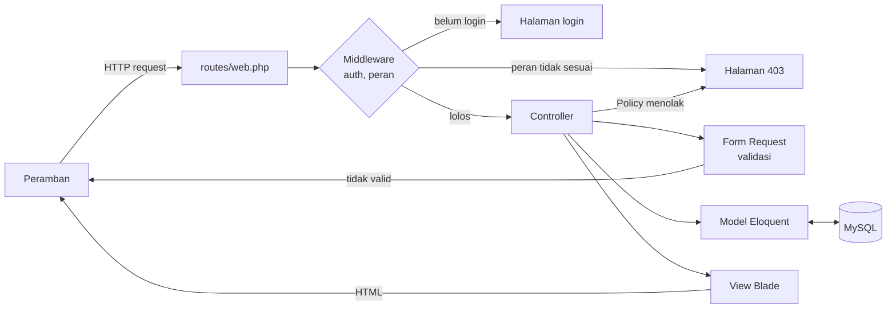

# 00 · Gambaran Umum Kode SIMONEV-CPL

Catatan ini menjelaskan susunan aplikasi secara keseluruhan. Penjelasan rinci tiap bagian ada di
catatan per iterasi (`01-…`, `02-…`, dan seterusnya).

## 1. Alur sebuah request di Laravel

Setiap kali pengguna membuka halaman atau mengirim form, Laravel memprosesnya dengan urutan berikut.



1. **Route** (`routes/web.php`) mencocokkan alamat dan metode (GET/POST/PUT) dengan controller yang
   menanganinya.
2. **Middleware** memeriksa request sebelum sampai ke controller. `auth` memastikan pengguna sudah
   login. `peran` (class `CekPeran`) memastikan peran aktif pengguna boleh membuka halaman itu.
3. **Controller** dibuat tipis: hanya menerima request, memanggil model, lalu mengembalikan view
   atau redirect.
4. **Form Request** (folder `app/Http/Requests`) berisi aturan validasi. Jika data tidak valid,
   Laravel otomatis kembali ke form beserta pesan error berbahasa Indonesia dari `lang/id/validation.php`.
5. **Model Eloquent** (folder `app/Models`) mewakili satu tabel dan relasinya.
6. **View Blade** (folder `resources/views`) menyusun HTML. Bagian yang dipakai berulang (kartu,
   tombol, input, layout) dibuat sebagai Blade component di `resources/views/components`.

Logika perhitungan capaian (mulai iterasi 7) hanya ada di `app/Services/CapaianService.php`, supaya
rumusnya tidak tersebar di controller atau view.

## 2. Struktur folder yang dipakai

```text
app/
  Http/
    Controllers/          controller tipis (Auth/LoginController, PeranAktifController, ...)
      Admin/              halaman Admin: data master, pemetaan, akun pengguna, beranda
      Koprodi/            halaman Koprodi (read-only)
      Dosen/              halaman Dosen: dashboard, mata kuliah, rencana asesmen, input nilai
      Mahasiswa/          halaman Capaian Pembelajaran Mahasiswa
      Controller.php      method bersama: kurikulum terpilih, pencarian, jumlah per halaman
    Middleware/CekPeran.php
    Requests/             Form Request untuk validasi (Admin/ dan Dosen/)
  Models/                 29 model Eloquent (19 model biasa + 10 model pivot)
    Concerns/BisaDicari.php  trait pencarian "Cari data..."
  Policies/               KelasKuliahPolicy, MataKuliahPolicy (hak akses dosen)
  Services/               CapaianService (semua rumus capaian), LaporanCapaian, FilterLaporan, CapaianMahasiswa,
                          MatriksPemetaan, MatriksBobotKelas
  Support/Angka.php       format angka berkoma desimal ("78,40")
bootstrap/app.php         pendaftaran middleware 'peran' dan arah redirect login
config/
  capaian.php             ambang batas capaian dari .env
  menu.php                menu sidebar per peran
database/
  migrations/             satu file per tabel
  factories/              pembuat data palsu untuk test
  seeders/                data awal: peran dan akun demo
lang/id/                  pesan validasi dan login berbahasa Indonesia
resources/
  css/app.css             Tailwind CSS v4 + token warna (bagian 7.2 spesifikasi)
  js/app.js               Alpine.js (sidebar/drawer, form) dan grafik Chart.js
  views/
    components/           Blade component: layouts, top-bar, sidebar, kartu, tombol, input, tabel,
                          paginasi, modal-hapus, select, badge, kartu-statistik, ...
    admin/                halaman Admin, satu folder per data (index + form), pemetaan
    koprodi/              halaman Koprodi
    dosen/                halaman Dosen
    laporan/              Laporan Capaian (dipakai Koprodi dan Dosen)
    mahasiswa/            Capaian Pembelajaran Mahasiswa
    auth/, peran-aktif/, profil/, password/, errors/
routes/web.php            semua route halaman
scripts/cek-tampilan.mjs  pengecekan tampilan semua halaman di Chrome (npm run cek:tampilan)
tests/Feature/            test fitur (Auth, Akun, Admin, Koprodi, Dosen, Mahasiswa, Database, laporan)
  SkenarioBlackBoxTest.php  16 skenario uji black box (bagian 12 spesifikasi) dengan data demo
tests/Unit/               unit test CapaianService (Uji 1–6)
tests/Support/            trait pembantu menyusun data uji
docs/                     spesifikasi, keputusan desain, catatan kode
  pengujian/black-box.md  hasil pengujian black box untuk Bab 4
```

## 3. Daftar tabel dan model

Semua tabel memakai primary key `<tabel>_id` bertipe UUID v7 dan kolom `created_at`/`updated_at`.
Nama model mengikuti istilah ERD dalam bahasa Indonesia. Model **pivot** adalah model untuk tabel
penghubung banyak-ke-banyak (lihat catatan 01, bagian 4).

| Kelompok ERD | Tabel | Model | Jenis |
|---|---|---|---|
| A. Pengguna | `users` | `User` | model (akun login) |
| | `roles` | `Role` | model |
| | `user_roles` | `UserRole` | pivot |
| | `dosen` | `Dosen` | model |
| | `mahasiswa` | `Mahasiswa` | model |
| B. Kurikulum | `program_studi` | `ProgramStudi` | model |
| | `kurikulum` | `Kurikulum` | model |
| | `evaluasi_kurikulum` | `EvaluasiKurikulum` | model |
| | `profil_lulusan` | `ProfilLulusan` | model |
| | `profesi` | `Profesi` | model |
| | `profil_lulusan_profesi` | `ProfilLulusanProfesi` | pivot |
| | `cpl` | `Cpl` | model |
| | `bahan_kajian` | `BahanKajian` | model |
| | `mata_kuliah` | `MataKuliah` | model |
| | `cpmk` | `Cpmk` | model |
| | `sub_cpmk` | `SubCpmk` | model |
| | `metode_penilaian` | `MetodePenilaian` | model |
| | `sub_cpmk_penilaian` | `SubCpmkPenilaian` | pivot |
| C. Pemetaan | `pemetaan_cpl_pl` | `PemetaanCplPl` | pivot |
| | `pemetaan_cpl_bk` | `PemetaanCplBk` | pivot |
| | `pemetaan_bk_mk` | `PemetaanBkMk` | pivot |
| | `pemetaan_cpmk_mk` | `PemetaanCpmkMk` | pivot, punya anak `sub_cpmk` |
| D. Pelaksanaan | `periode_akademik` | `PeriodeAkademik` | model |
| | `kelas_kuliah` | `KelasKuliah` | model |
| | `dosen_kelas` | `DosenKelas` | pivot |
| | `peserta_kelas` | `PesertaKelas` | pivot, punya anak `nilai_asesmen` |
| E. Asesmen & nilai | `rencana_asesmen` | `RencanaAsesmen` | model |
| | `rencana_asesmen_sub_cpmk` | `RencanaAsesmenSubCpmk` | pivot |
| | `nilai_asesmen` | `NilaiAsesmen` | model |

Selain 29 tabel ERD, ada tiga tabel bawaan Laravel: `sessions` (data login yang sedang berjalan),
`cache` dan `cache_locks` (dipakai pembatas percobaan login), ditambah tabel `migrations` yang mencatat
migrasi yang sudah dijalankan (KD-18).

## 4. Menjalankan proyek dan test

Langkah lengkap ada di [README](../../README.md). Ringkasnya:

```bash
composer install && npm install
cp .env.example .env && php artisan key:generate   # lalu isi DB_PASSWORD di .env
php artisan migrate --seed                         # membuat tabel dan akun demo
npm run dev                                        # terminal 1
php artisan serve                                  # terminal 2, buka http://localhost:8000
php artisan test                                   # menjalankan test (database simonev_cpl_test)
php artisan test --filter=SkenarioBlackBoxTest     # hanya 16 skenario uji black box
npm run cek:tampilan                               # cek tampilan semua halaman (aplikasi harus berjalan)
```
