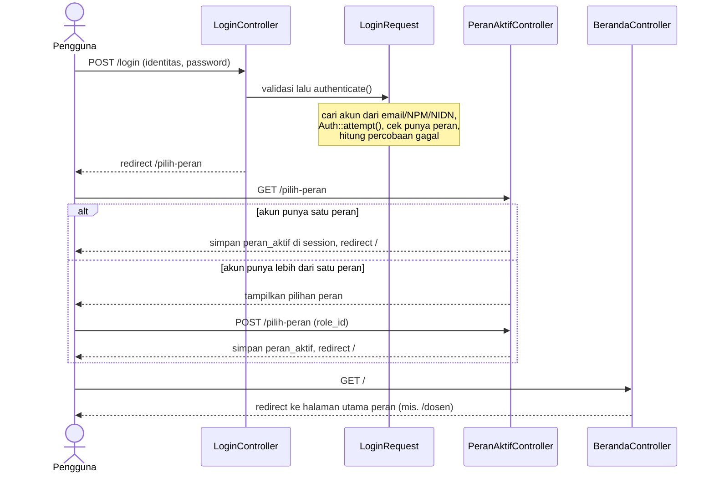
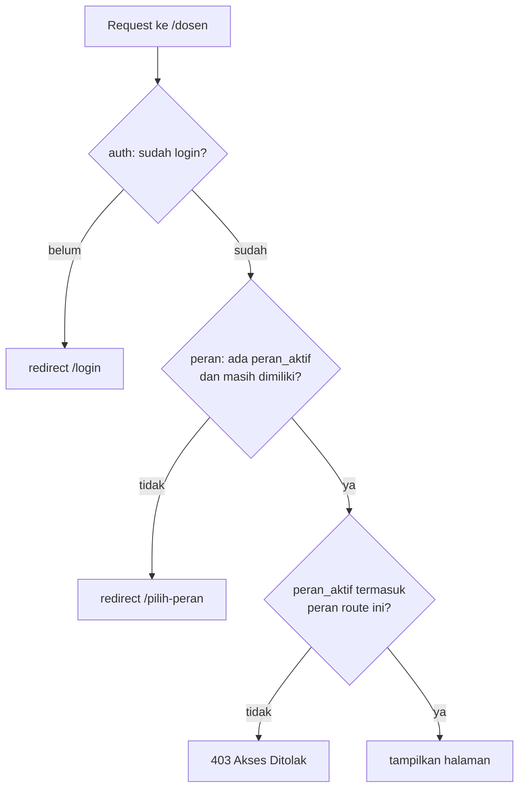

# 01 · Setup Proyek, Autentikasi, dan Peran

Catatan iterasi 1 (bagian 11 spesifikasi). Dibaca setelah [00-gambaran-umum.md](00-gambaran-umum.md).

## 1. Tujuan dan kebutuhan yang dipenuhi

Iterasi ini menyiapkan fondasi yang dipakai semua fitur berikutnya:

- proyek Laravel 13 dengan MySQL, bahasa Indonesia, zona waktu WIT, dan tampilan Tailwind + Alpine.js;
- **semua tabel ERD** (29 tabel) dengan primary key UUID, beserta model Eloquent dan relasinya;
- seeder empat peran dan lima akun demo;
- login dengan email, NPM, atau NIDN; pilih/ganti peran aktif; logout;
- pembatasan akses per peran di server (middleware `peran`) dan halaman error berbahasa Indonesia;
- halaman Profil dan Ubah Password.

Kebutuhan yang dipenuhi:

- **KNF-01:** aplikasi berbasis web.
- **KNF-02:** antarmuka sederhana.
- **KNF-03:** autentikasi dan pembatasan akses berdasarkan peran, password di-hash, proteksi CSRF.
- **KNF-04:** tampilan responsif mulai lebar 360px.
- **Skenario uji bagian 12:** nomor 1 (login valid), 2 (login salah), dan 3 (hak akses).
- **Dasar KF lain:** semua KF berikutnya memakai login, peran, dan tabel dari iterasi ini.

## 2. File yang dibuat atau diubah

| File | Peran |
|---|---|
| `database/migrations/0001_01_01_000000_create_users_table.php` | Tabel `users` (PK UUID, kolom `nama`, email boleh kosong) dan `sessions` |
| `database/migrations/2026_10_30_0000xx_create_*_table.php` | 28 tabel ERD lainnya, satu file per tabel |
| `app/Models/*.php` | 29 model: 19 model biasa dan 10 model pivot |
| `database/factories/*.php` | Pembuat data palsu untuk test |
| `database/seeders/RoleSeeder.php`, `AkunDemoSeeder.php` | Empat peran dan lima akun demo |
| `app/Http/Requests/LoginRequest.php` | Validasi login, pencocokan identitas, pembatas percobaan |
| `app/Http/Controllers/Auth/LoginController.php` | Menampilkan form login, login, logout |
| `app/Http/Controllers/PeranAktifController.php` | Pilih dan ganti peran aktif |
| `app/Http/Requests/PilihPeranRequest.php` | Validasi `role_id` (`uuid` + `exists`) |
| `app/Http/Middleware/CekPeran.php` | Middleware `peran`: cek peran aktif, 403 jika tidak sesuai |
| `app/Http/Controllers/BerandaController.php` | Mengarahkan `/` ke halaman utama peran aktif |
| `app/Http/Controllers/ProfilController.php`, `PasswordController.php`, `app/Http/Requests/UbahPasswordRequest.php` | Profil dan ubah password |
| `routes/web.php`, `bootstrap/app.php` | Daftar route dan pendaftaran middleware |
| `resources/css/app.css`, `resources/js/app.js`, `vite.config.js` | Token warna, font, Alpine.js |
| `resources/views/components/*` | Layout `app`/`guest`, `top-bar`, `sidebar`, `menu-akun`, `kartu`, `tombol`, `input`, `toast`, `logo`, `halaman-error` |
| `resources/views/{auth,peran-aktif,beranda,profil,password,errors}/*` | Halaman-halaman iterasi ini |
| `config/capaian.php`, `config/menu.php` | Ambang capaian dari `.env` dan menu sidebar per peran |
| `lang/id/*.php` | Pesan validasi dan login berbahasa Indonesia |
| `tests/TestCase.php`, `tests/Feature/**` | Pengaman database test dan seluruh test iterasi ini |

## 3. Alur kerja

### Login sampai halaman utama



### Membuka halaman yang dilindungi



## 4. Penjelasan potongan kode penting

### a. Migrasi dengan UUID dan aturan hapus

```php
$table->uuid('rencana_asesmen_sub_cpmk_id')->primary();
$table->foreignUuid('rencana_asesmen_id')->constrained('rencana_asesmen', 'rencana_asesmen_id')->cascadeOnDelete();
$table->foreignUuid('sub_cpmk_id')->constrained('sub_cpmk', 'sub_cpmk_id')->restrictOnDelete();
$table->decimal('bobot_kontribusi', 5, 2);
$table->unique(['rencana_asesmen_id', 'sub_cpmk_id']);
```

- `uuid(...)->primary()` membuat kolom `CHAR(36)` sebagai primary key.
- `foreignUuid(...)->constrained(tabel, kolom)` membuat kolom FK sekaligus foreign key constraint. Nama
  kolom tujuan ditulis karena PK kita bernama `<tabel>_id`, bukan `id`.
- `cascadeOnDelete()`: jika rencana asesmen dihapus, baris pemetaannya ikut terhapus.
  `restrictOnDelete()`: Sub-CPMK yang masih dipakai di sini **tidak bisa** dihapus. Dengan begitu bobot
  kelas lama tidak hilang diam-diam (KD-20, bagian 5.1).
- `unique([...])` adalah tanda `UQ(a, b)` di ERD.

### b. Model pivot ber-UUID

```php
// app/Models/RencanaAsesmen.php
public function subCpmk(): BelongsToMany
{
    return $this->belongsToMany(SubCpmk::class, 'rencana_asesmen_sub_cpmk', 'rencana_asesmen_id', 'sub_cpmk_id')
        ->using(RencanaAsesmenSubCpmk::class)
        ->withPivot('rencana_asesmen_sub_cpmk_id', 'bobot_kontribusi')
        ->withTimestamps();
}

// app/Models/RencanaAsesmenSubCpmk.php
class RencanaAsesmenSubCpmk extends Pivot
{
    use HasUuids;

    protected $table = 'rencana_asesmen_sub_cpmk';

    protected $primaryKey = 'rencana_asesmen_sub_cpmk_id';
}
```

- Tanpa `->using(...)`, perintah `attach()` atau `sync()` menulis baris pivot langsung lewat query
  builder, sehingga kolom PK UUID tidak terisi dan MySQL menolak.
- Dengan `->using(...)`, Laravel membuat baris pivot lewat model `RencanaAsesmenSubCpmk`. Trait
  `HasUuids` di model itu mengisi PK dengan UUID v7 sebelum data disimpan.
- `withPivot` membuat kolom tambahan (mis. `bobot_kontribusi`) bisa dibaca lewat `$subCpmk->pivot`.
- `withTimestamps` mengisi `created_at` dan `updated_at`.

### c. Mencari akun dari email, NPM, atau NIDN

```php
public static function cariBerdasarkanIdentitas(string $identitas): ?self
{
    return self::where('email', $identitas)->first()
        ?? Mahasiswa::where('nim', $identitas)->first()?->user
        ?? Dosen::where('nidn', $identitas)->first()?->user;
}
```

Operator `??` mencoba pencarian berikutnya hanya jika pencarian sebelumnya menghasilkan `null`.
Operator `?->` mencegah error ketika mahasiswa atau dosen tidak ditemukan.

### d. Login dan pembatasan percobaan

```php
public function authenticate(): void
{
    $this->pastikanTidakDibatasi();

    $user = User::cariBerdasarkanIdentitas($this->string('identitas')->trim()->value());

    if ($user === null || ! Auth::attempt(['user_id' => $user->user_id, 'password' => $this->input('password')])) {
        RateLimiter::hit($this->kunciPembatas());

        throw ValidationException::withMessages(['identitas' => __('auth.failed')]);
    }

    if ($user->roles()->doesntExist()) {
        Auth::logout();

        throw ValidationException::withMessages(['identitas' => __('auth.tanpa_peran')]);
    }

    RateLimiter::clear($this->kunciPembatas());
}
```

- `Auth::attempt` mencari akun dengan `user_id` itu, lalu membandingkan password dengan hash bcrypt
  di database. Jika cocok, pengguna langsung login.
- Setiap kegagalan dicatat `RateLimiter::hit` dengan kunci `identitas|IP`, dan catatannya kedaluwarsa
  setelah 60 detik.
- `pastikanTidakDibatasi()` menolak percobaan berikutnya setelah 5 kali gagal (bagian 6 spesifikasi).
- Pesan yang sama ("Email/NPM/NIDN atau password salah.") dipakai untuk identitas yang tidak terdaftar
  dan untuk password yang salah. Dengan begitu penyerang tidak bisa menebak akun mana yang ada.

### e. Middleware peran

```php
public function handle(Request $request, Closure $next, string ...$peranDiizinkan): Response
{
    $peranAktif = $request->user()->roles->firstWhere('kode_role', $request->session()->get('peran_aktif'));

    if ($peranAktif === null) {
        $request->session()->forget('peran_aktif');

        return redirect()->route('peran-aktif.create');
    }

    if ($peranDiizinkan !== [] && ! in_array($peranAktif->kode_role, $peranDiizinkan, true)) {
        abort(403);
    }

    View::share('peranAktif', $peranAktif);

    return $next($request);
}
```

- **Pemasangan.** Route memasang middleware ini dengan `->middleware('peran:DOSEN')`. Teks setelah
  titik dua masuk ke parameter `...$peranDiizinkan`.
- **Peran aktif dicek ulang setiap request.** Peran aktif dicari di antara peran yang masih dimiliki
  akun. Jika Admin mencabut peran itu, `$peranAktif` menjadi `null`, sehingga pengguna diminta memilih
  peran lagi.
- **Penolakan di server.** `abort(403)` menampilkan `resources/views/errors/403.blade.php`. Akses
  ditolak di server, bukan sekadar menyembunyikan menu (bagian 3 spesifikasi).
- **Data untuk view.** `View::share` membagikan data peran aktif ke semua view, sehingga top bar dan
  sidebar bisa menampilkan nama peran dan menunya.

### f. Token warna Tailwind v4

```css
@theme {
    --color-*: initial;
    --color-primary-900: #1e3a8a;
    --color-accent: #facc15;
    --color-text-muted: #475569;
}
```

- **Nama kelas otomatis.** Setiap variabel `--color-<nama>` otomatis menjadi kelas Tailwind seperti
  `bg-<nama>`, `text-<nama>`, dan `border-<nama>`.
- **Palet bawaan dimatikan.** Baris `--color-*: initial` menghapus palet bawaan Tailwind (mis.
  `bg-red-500`). Akibatnya view hanya bisa memakai warna dari palet bagian 7.2 (KD-32).

### g. Sidebar dan drawer dengan Alpine.js

```js
Alpine.data('tataLetak', () => ({
    sidebarDesktop: true,
    drawerMobile: false,
    alihkanSidebar() { /* desktop: sembunyikan sidebar; mobile: buka/tutup drawer */ },
    tutupDrawer() { this.drawerMobile = false; },
}));
```

Layout memasang `x-data="tataLetak"` di `<body>`. Tombol hamburger memanggil `alihkanSidebar()`.
Latar gelap, tombol Esc, dan klik menu memanggil `tutupDrawer()` (bagian 7.4).

## 5. Hubungan dengan proposal dan spesifikasi

- **Basis data:**
  - Seluruh tabel kelompok A–E di ERD (bagian 4) dibuat dengan nama tabel dan kolom yang sama persis.
  - Tanda UQ di ERD menjadi unique index.
  - Kode kurikulum unik per kurikulum (KD-07).
  - Aturan hapus mengikuti KD-20.
- **Peran pengguna:** empat peran mengikuti bagian 3. Satu akun boleh punya lebih dari satu peran
  (`user_roles`) dan memilih peran aktif.
- **Validasi:** login salah ditolak, ada batas 5 kali gagal per menit, dan akses di luar peran
  menghasilkan 403 (bagian 6).
- **Antarmuka:** warna, tipografi, top bar, sidebar, dan halaman login mengikuti bagian 7. Ukuran
  sentuh 44px dan input 16px di mobile mengikuti bagian 7.4.
- **Perhitungan:** belum ada rumus di iterasi ini. Yang sudah disiapkan baru `config/capaian.php`
  (bagian 5.3), yang dipakai mulai iterasi 7.

## 6. Konsep Laravel yang muncul

- **Migration:** file PHP yang membuat atau mengubah tabel, sehingga struktur database bisa dibuat
  ulang dengan `php artisan migrate`.
- **Eloquent model dan relasi:** class yang mewakili tabel. Contohnya `belongsTo` (milik satu),
  `hasMany` (punya banyak), dan `belongsToMany` (banyak-ke-banyak lewat tabel pivot).
- **Model Pivot dan `->using()`:** model untuk tabel penghubung, dipakai agar PK UUID pivot terisi.
- **UUID (`HasUuids`):** ID acak 36 karakter. Versi 7 diawali waktu pembuatan, jadi urutannya tetap
  rapi di index database.
- **Factory dan Seeder:** factory membuat data palsu untuk test, sedangkan seeder mengisi data awal
  (peran dan akun demo).
- **Middleware:** penyaring request sebelum masuk controller (`auth`, `guest`, `peran`).
- **Form Request:** class khusus validasi, sehingga controller tetap tipis.
- **Session:** penyimpanan data per pengguna di server (tabel `sessions`). Contohnya `peran_aktif`.
- **RateLimiter:** penghitung percobaan yang disimpan di cache, dipakai untuk membatasi login gagal.
- **CSRF:** token `@csrf` di setiap form agar form tidak bisa dikirim dari situs lain. Ini bawaan Laravel.
- **Blade component:** potongan view yang dipakai ulang, mis. `<x-tombol>` dan `<x-layouts.app>`.
  `@props` mendefinisikan isian yang diterima komponen.
- **`View::share`:** membagikan data ke semua view.
- **Vite:** alat yang mengemas CSS/JS. `npm run dev` dipakai saat pengembangan, `npm run build` untuk
  hasil akhir.
- **Feature test, `RefreshDatabase`, dan `DataProvider`:**
  - Feature test mensimulasikan request ke aplikasi.
  - `RefreshDatabase` menyiapkan database test yang bersih untuk setiap test.
  - `DataProvider` menjalankan satu test dengan beberapa set data.

## 7. Cara mencoba dan menjalankan test

Mencoba manual (setelah `php artisan migrate --seed`, `npm run dev`, dan `php artisan serve`):

1. Buka <http://localhost:8000>. Karena belum login, Anda diarahkan ke halaman login.
2. Login dengan password salah. Pesan "Email/NPM/NIDN atau password salah." muncul. Setelah 5 kali
   salah dalam semenit, login diblokir sementara.
3. Login sebagai `dosen@simonev.test` / `dosen123`, atau dengan NIDN `9990000001`. Anda langsung
   masuk ke Dashboard Dosen.
4. Buka <http://localhost:8000/admin>. Halaman 403 "Akses Ditolak" muncul.
5. Keluar, lalu login sebagai `koprodi.dosen@simonev.test` / `koprodi.dosen123`. Pilih salah satu
   peran, lalu coba menu akun → **Ganti Peran**.
6. Buka **Profil** dan **Ubah Password** dari menu akun.
7. Perkecil jendela peramban sampai di bawah 1024px. Sidebar berubah menjadi drawer yang dibuka
   dengan tombol hamburger.

Menjalankan test:

```bash
php artisan test                         # semua test
php artisan test --filter=LoginTest      # satu kelas test saja
```

## 8. Ringkasan iterasi

- **Tanggal:** 30 Oktober 2026.
- **Hasil test:** 78 test (243 assertion) lulus di MySQL 8.0.46, dan Pint bersih.
- **Pemeriksaan test:** tujuh kesalahan sengaja dimasukkan ke kode satu per satu, lalu test dijalankan.
  Contohnya menghapus `abort(403)` di `CekPeran`, menaikkan batas login menjadi 50, dan mengganti
  `restrictOnDelete` peran menjadi `cascadeOnDelete`. Setiap kesalahan membuat test yang terkait gagal,
  jadi test benar-benar memeriksa perilaku yang dimaksud, bukan sekadar lulus.
- **Tampilan:** halaman login, pilih peran, halaman utama, drawer, menu akun, profil, ubah password,
  403, dan 404 sudah dicek lewat tangkapan layar Chrome headless di lebar 360, 768, dan 1280px. Tidak
  ada halaman yang bergeser horizontal.
- **Kendala:**
  - Database `simonev_cpl_test` belum ada di MySQL laptop selama pengerjaan, dan user `simonev` tidak
    berhak membuat database. Test akhirnya dijalankan di server MySQL sementara dengan versi yang sama
    (8.0.46), yang dijalankan tanpa `sudo` di folder sementara. Akibatnya, test baru bisa dijalankan
    setelah kodenya selesai. Pemeriksaan dengan kesalahan buatan di atas dilakukan untuk menutup
    kekurangan itu.
  - Tangkapan layar menu akun di layar kecil sempat tampak tertutup. Penyebabnya, gambar diambil saat
    animasi latar drawer belum selesai, jadi bukan kesalahan kode. Dengan jeda 400 ms, menu tampil
    normal.
- **Perlu diputuskan atau disediakan:**
  - Jalankan perintah pembuatan `simonev_cpl_test` di README (butuh `sudo`), lalu `php artisan test`.
  - Sediakan file `public/images/logo-unkhair.png`. Selama file belum ada, sidebar dan halaman login
    menampilkan teks "UNKHAIR".
  - Ambang AM dan AK di `.env` masih contoh APTIKOM (50.01 dan 85). Angka resmi prodi dibutuhkan
    sebelum iterasi 7.

## 9. Pertanyaan yang mungkin diajukan penguji

1. **Mengapa primary key memakai UUID, bukan angka urut?**
   Spesifikasi meminta UUID untuk semua tabel. UUID tidak bisa ditebak dari URL (mis. `/kelas/5`
   lalu dicoba `/kelas/6`). UUID juga tidak bentrok jika data digabung dari beberapa sumber. Versi 7
   diawali waktu, sehingga index tetap efisien.
2. **Mengapa tabel pivot dibuat model sendiri?**
   Di ERD setiap pivot punya PK sendiri. Cara bawaan Laravel (`attach`) tidak mengisi PK itu.
   Dengan model pivot ber-`HasUuids` yang dipasang lewat `->using()`, PK terisi otomatis. Hal ini
   dibuktikan oleh `UuidTest`.
3. **Bagaimana sistem tahu peran yang sedang dipakai pengguna?**
   Kode peran disimpan di session `peran_aktif` saat pengguna memilih peran. Middleware `peran`
   memeriksanya di setiap request.
4. **Apa yang terjadi jika mahasiswa mengetik alamat halaman admin?**
   Middleware `peran:ADMIN` menolak dengan 403. Pemeriksaan ini terjadi di server, jadi tidak cukup
   hanya menyembunyikan menu. Semua kombinasi lintas peran diuji di `HakAksesTest`.
5. **Bagaimana password disimpan dan dilindungi?**
   Password di-hash dengan bcrypt (cast `hashed` di model `User`), jadi tidak pernah tersimpan
   sebagai teks asli. Login dibatasi 5 kali gagal per menit, dan setiap form dilindungi token CSRF.
6. **Mengapa test memakai database MySQL, bukan SQLite?**
   Supaya hasil test berlaku untuk database yang benar-benar dipakai. Contohnya, MySQL menganggap
   `CPL01` dan `cpl01` sama sedangkan SQLite tidak. Ada juga pengaman agar test tidak pernah
   mengosongkan database pengembangan (KD-17).
7. **Mengapa Sub-CPMK yang sudah dipakai rencana asesmen tidak bisa dihapus?**
   Bobot kontribusinya adalah dasar perhitungan capaian kelas. Jika ikut terhapus, capaian kelas
   lama berubah diam-diam. Itu melanggar prinsip bagian 5.1 (KD-08, KD-20).
