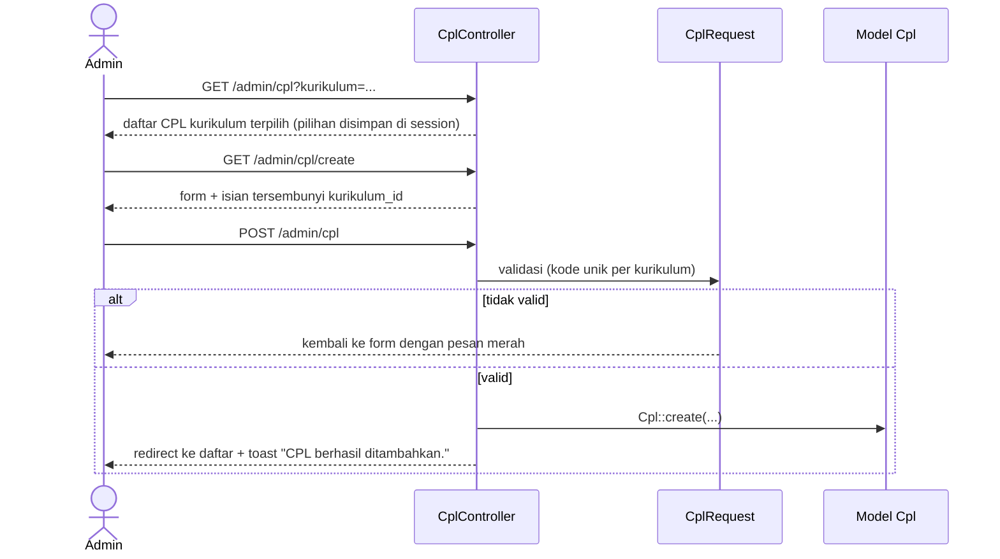
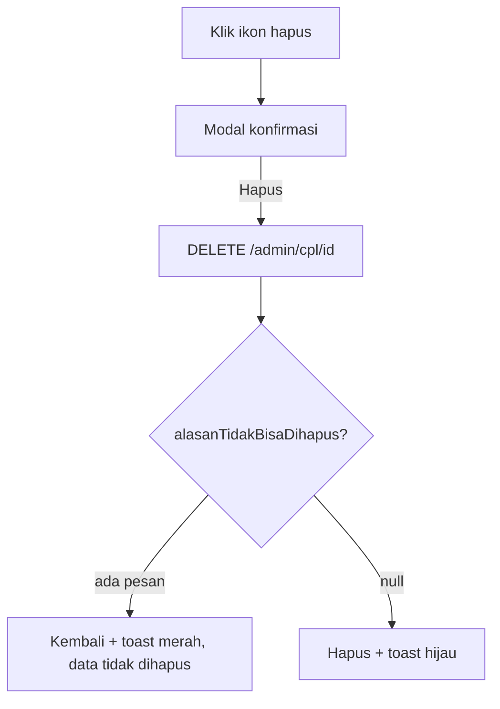

# 02 · Akun Pengguna dan Data Master

Catatan iterasi 2 (bagian 11 spesifikasi). Dibaca setelah [01-setup-autentikasi-peran.md](01-setup-autentikasi-peran.md).

## 1. Tujuan dan kebutuhan yang dipenuhi

Admin bisa mengelola seluruh data dasar sistem:

- akun pengguna dan perannya;
- data Dosen dan Mahasiswa, yang sekaligus membuat akun login;
- data master kurikulum: Program Studi, Kurikulum, Evaluasi Kurikulum, Profil Lulusan, Profesi,
  CPL, Bahan Kajian, Mata Kuliah, CPMK, dan Metode Penilaian;
- Beranda Admin berisi ringkasan jumlah data.

Sub-CPMK dikerjakan di iterasi 3, karena Sub-CPMK menempel ke pasangan CPMK–MK hasil matriks
pemetaan (KD-35).

Kebutuhan yang dipenuhi:

- **KF-02:** kelola akun dan peran pengguna.
- **KF-03:** kelola data master kurikulum, termasuk evaluasi kurikulum.
- **KNF-02 dan KNF-04:** antarmuka sederhana dan responsif.
- **Skenario uji bagian 12:** nomor 4 (Admin menambahkan data master).

## 2. File yang dibuat atau diubah

| File | Peran |
|---|---|
| `routes/web.php` | Grup route `/admin` dengan middleware `peran:ADMIN` dan `Route::resource` per data |
| `app/Http/Controllers/Controller.php` | Method bersama: `kurikulumTerpilih()`, `kataPencarian()`, `jumlahPerHalaman()` |
| `app/Http/Controllers/Admin/*Controller.php` | Satu controller per data, berisi `index`, `create`, `store`, `edit`, `update`, `destroy` |
| `app/Http/Requests/Admin/DataKurikulumRequest.php` | Dasar validasi untuk data milik satu kurikulum |
| `app/Http/Requests/Admin/*Request.php` | Aturan validasi tiap form |
| `app/Models/Concerns/BisaDicari.php` | Trait pencarian "Cari data..." |
| `app/Models/*.php` | Tambahan `$kolomPencarian`, `alasanTidakBisaDihapus()`, `Kurikulum::terbaru()`, `PeriodeAkademik::aktif()`, serta pembuatan akun Dosen/Mahasiswa |
| `resources/views/admin/<data>/index.blade.php` | Halaman daftar: dropdown kurikulum, pencarian, tabel, paginasi |
| `resources/views/admin/<data>/form.blade.php` | Satu form untuk tambah dan ubah |
| `resources/views/admin/beranda.blade.php`, `admin/akun/*` | Beranda Admin dan Akun Pengguna |
| `resources/views/components/tabel/*`, `paginasi`, `modal-hapus`, `alat-daftar`, `select`, `textarea`, `kotak-centang`, `badge`, `kartu-statistik`, `kosong`, `tombol-ikon`, `tombol-hapus`, `form-aksi` | Komponen Blade baru |
| `resources/views/components/sidebar.blade.php`, `config/menu.php` | Menu bergrup "Data Master" |
| `database/seeders/DataMasterDemoSeeder.php` | Data contoh data master |
| `lang/id/validation.php` | Nama isian berbahasa Indonesia untuk pesan validasi |
| `tests/Feature/Admin/*`, `tests/Feature/Database/SeederTest.php` | Test iterasi ini |

## 3. Alur kerja

### Menambah CPL



### Menghapus data



## 4. Penjelasan potongan kode penting

### a. Kurikulum terpilih

```php
protected function kurikulumTerpilih(Request $request): ?Kurikulum
{
    $kurikulumId = $request->query('kurikulum', $request->session()->get('kurikulum_terpilih'));
    $kurikulum = is_string($kurikulumId) && Str::isUuid($kurikulumId) ? Kurikulum::find($kurikulumId) : null;
    $kurikulum ??= Kurikulum::terbaru();
    ...
    $request->session()->put('kurikulum_terpilih', $kurikulum->kurikulum_id);
}
```

- **Urutan sumber pilihan.** Pertama dicek pilihan dari dropdown (`?kurikulum=`), lalu pilihan yang
  disimpan di session, lalu kurikulum terbaru.
- **Kurikulum terbaru.** `Kurikulum::terbaru()` mengurutkan dari `tahun_berlaku` terbesar, bukan dari
  urutan id (bagian 4 spesifikasi).
- **Diingat selama sesi.** Pilihan disimpan lagi di session, jadi berpindah dari halaman CPL ke CPMK
  tetap memakai kurikulum yang sama (KD-51).

### b. Kode unik per kurikulum

```php
'kode_cpl' => [
    'required', 'string', 'max:20',
    Rule::unique('cpl', 'kode_cpl')->where('kurikulum_id', $this->kurikulumId())->ignore($this->dataLama()),
],
```

- **`where('kurikulum_id', ...)`.** Pengecekan unik hanya dilakukan di kurikulum yang sama, jadi
  `CPL01` boleh ada di kurikulum 2021 dan 2026.
- **`ignore(...)`.** Saat mengubah data, baris itu sendiri tidak dianggap ganda.
- **Huruf besar/kecil.** MySQL membandingkan teks tanpa membedakan huruf besar/kecil (collation
  `utf8mb4_unicode_ci`), jadi `cpl01` dianggap sama dengan `CPL01`.
- **Kasus CPMK.** Tabel `cpmk` tidak punya `kurikulum_id`. Karena itu `CpmkRequest` memakai aturan
  closure yang mencari CPMK berkode sama lewat relasi `cpl`.

### c. Pemeriksaan sebelum hapus

```php
// app/Models/Cpl.php
public function alasanTidakBisaDihapus(): ?string
{
    return $this->cpmk()->exists()
        ? 'CPL tidak bisa dihapus karena masih memiliki CPMK.'
        : null;
}

// CplController::destroy
if ($pesan = $cpl->alasanTidakBisaDihapus()) {
    return back()->with('gagal', $pesan);
}
```

- **Pengecekan di model.** Model memeriksa data yang merujuk ke dirinya. Jika masih ada, model
  mengembalikan kalimat penjelasan.
- **Pesan ke pengguna.** Controller menampilkan kalimat itu sebagai toast merah (session `gagal`).
- **Pengaman terakhir.** Foreign key `restrict` di database tetap menolak penghapusan jika pengecekan
  di aplikasi terlewat (KD-20, KD-52).
- **Data pemetaan.** Pemetaan seperti `pemetaan_cpl_pl` tidak menghalangi penghapusan, karena ikut
  terhapus lewat `cascadeOnDelete`.

### d. Dosen sekaligus akunnya

```php
public static function buatBesertaAkun(array $data): self
{
    return DB::transaction(function () use ($data) {
        $user = User::create(['nama' => $data['nama'], 'email' => $data['email'] ?? null, 'password' => $data['password']]);
        $user->roles()->attach(Role::ambil(Role::DOSEN));

        return $user->dosen()->create(['nidn' => $data['nidn'], 'nama' => $data['nama']]);
    });
}
```

- **Satu transaksi.** `DB::transaction` membuat ketiga langkah tersimpan bersama. Jika satu gagal,
  semuanya dibatalkan, sehingga tidak ada akun tanpa data dosen.
- **Password di-hash otomatis.** Cast `hashed` di model `User` meng-hash password sebelum disimpan.
- **Menghapus dosen.** `hapusBesertaAkun()` mencabut peran DOSEN, lalu menghapus akunnya hanya jika
  akun itu tidak punya peran lain (KD-36). Contohnya, Koprodi yang juga dosen tetap bisa login
  sebagai Koprodi.

### e. Tabel yang menjadi kartu di layar kecil

```blade
<x-tabel :kolom="['Kode', 'Kategori', 'Deskripsi', 'Aksi']">
    <x-tabel.baris>
        <x-tabel.sel label="Kode">{{ $dataCpl->kode_cpl }}</x-tabel.sel>
        <x-tabel.sel label="Deskripsi" :panjang="true">...</x-tabel.sel>
        <x-tabel.aksi>...</x-tabel.aksi>
    </x-tabel.baris>
</x-tabel>
```

- **Label kolom di setiap sel.** Komponen `x-tabel.sel` menulis `data-label="Kode"` pada `<td>`.
- **Tampilan di layar < 768px.** Kelas `max-md:before:content-[attr(data-label)]` menampilkan label
  itu di kiri nilai. Akibatnya setiap baris tampil sebagai kartu label–nilai (bagian 7.4).
- **Teks panjang.** Sel dengan `:panjang="true"` meletakkan labelnya di atas teks.

### f. Modal hapus dengan Alpine.js

```blade
{{-- tombol --}}
x-on:click="$dispatch('konfirmasi-hapus', { aksi: '...', nama: 'CPL01' })"

{{-- modal (sekali di layout) --}}
x-on:konfirmasi-hapus.window="aksi = $event.detail.aksi; nama = $event.detail.nama; terbuka = true"
<form method="POST" x-bind:action="aksi"> @csrf @method('DELETE') ...
```

- **Membuka modal.** Tombol hapus mengirim event berisi alamat form dan nama data. Modal menangkap
  event itu, mengisi `action` form, lalu tampil.
- **Satu modal untuk semua.** Karena hanya ada satu modal di layout, semua halaman daftar memakainya
  bersama.
- **Tampilan.** Di mobile modal muncul sebagai bottom sheet, dan di desktop sebagai dialog di tengah.

## 5. Hubungan dengan proposal dan spesifikasi

- **Basis data:** nama tabel dan kolom sama dengan ERD kelompok A dan B. Kode unik per kurikulum
  mengikuti tanda UQ dan bagian 6.
- **Peran:** semua route `/admin` dilindungi `peran:ADMIN`. Peran lain mendapat 403 (bagian 3 dan 6).
- **Antarmuka:**
  - halaman daftar mengikuti Gambar 3.9: judul "Kelola Data Master …", pencarian, Tambah Data,
    tabel dengan aksi ubah/hapus, dan paginasi;
  - Beranda Admin mengikuti 7.6.3.
- **Data contoh:** mengikuti bagian 10. Kurikulum 2021 dan 2026 sama-sama punya PL01, CPL01,
  CPMK011, BK01, dan MK INF202.
- **Perhitungan:** belum ada di iterasi ini. Kolom bahan kajian (bobot, CS/KA Core) hanya dokumentasi
  (KD-22).

## 6. Konsep Laravel yang muncul

- **`Route::resource`:** satu baris yang membuat tujuh route standar (index, create, store, edit,
  update, destroy, show). `->except('show')` membuang route yang tidak dipakai, dan
  `->parameters([...])` menentukan nama parameter route.
- **Route model binding:** parameter `{cpl}` otomatis diubah menjadi model `Cpl` berdasarkan
  primary key UUID. Jika tidak ditemukan, hasilnya 404.
- **Form Request dengan `Rule::unique()->where()`, `Rule::exists()->where()`, dan `after()`:**
  berturut-turut dipakai untuk aturan unik bersyarat, memastikan data pilihan berasal dari kurikulum
  yang sama, dan validasi tambahan setelah aturan biasa (mis. Admin tidak boleh mencabut peran
  Admin miliknya).
- **Local scope (`scopeCari`) dan trait:** query yang bisa dipakai ulang, mis. `Cpl::cari('sikap')`.
- **`paginate()` dan `withQueryString()`:** membagi data per halaman sambil membawa filter dan
  pencarian ke tautan halaman berikutnya.
- **`DB::transaction`:** beberapa query yang harus berhasil semua atau batal semua.
- **Session flash (`with('sukses', ...)`):** pesan yang hanya tampil sekali, dipakai untuk toast.
- **Blade component dengan subfolder dan `index.blade.php`:** `<x-tabel>` dan `<x-tabel.sel>`.
- **Alpine `$dispatch` dan event `.window`:** komunikasi antarkomponen tanpa JavaScript tambahan.

## 7. Cara mencoba dan menjalankan test

Setelah `php artisan migrate:fresh --seed`, login sebagai `admin@simonev.test` / `admin123`, lalu:

1. **Beranda.** Tampil kartu jumlah mahasiswa (24), dosen (5), mata kuliah Kurikulum OBE 2026 (3),
   dan kelas (0).
2. **Dropdown kurikulum.** Buka Data Master → CPL. Ganti dropdown Kurikulum ke Kurikulum 2021;
   keduanya punya CPL01.
3. **Kode ganda.** Tambah CPL dengan kode `cpl01`. Muncul pesan "Kode CPL sudah dipakai di
   kurikulum ini."
4. **Hapus yang ditolak.** Hapus CPL01. Muncul pesan bahwa CPL masih memiliki CPMK.
5. **Dosen baru.** Data Master → Dosen → Tambah Data. Isi NIDN dan password awal, lalu logout dan
   login dengan NIDN itu.
6. **Akun Pengguna.** Ubah akun dosen itu, centang peran Koprodi, lalu coba reset password-nya.
7. **Tampilan mobile.** Perkecil jendela di bawah 768px. Tabel berubah menjadi kartu, dan modal hapus
   muncul dari bawah.

```bash
php artisan test --filter=Admin    # test iterasi ini
php artisan test                   # semua test
```

## 8. Ringkasan iterasi

- **Tanggal:** 30 Oktober 2026.
- **Hasil test:** 156 test lulus (78 di antaranya baru), dan Pint bersih.
- **Tampilan:** Beranda, daftar CPL, form CPL, modal hapus, Akun Pengguna, Mahasiswa, Bahan Kajian,
  form Profil Lulusan, Kurikulum, dan drawer sudah dicek dengan Chrome headless di lebar 360, 768,
  dan 1280px. Tidak ada halaman yang bergeser horizontal atau error JavaScript.
- **Kendala:**
  - Tahun acak dari `KurikulumFactory` kadang lebih baru dari tahun yang ditulis di test, sehingga
    "kurikulum terbaru" berubah-ubah. Rentang tahun factory diubah menjadi 2000–2019.
  - Kata "profesi" bisa dijadikan bentuk tunggal oleh Laravel menjadi "profesus". Karena itu nama
    parameter setiap `Route::resource` ditulis sendiri.
- **Perlu diputuskan:**
  - Sembilan rekomendasi sebelum iterasi 2 (KD-35 sampai KD-43) dipakai tanpa koreksi. Silakan tinjau
    jika ada yang ingin diubah.
  - Data contoh di `DataMasterDemoSeeder` adalah karangan. Data kurikulum asli diisi sendiri nanti.

## 9. Pertanyaan yang mungkin diajukan penguji

1. **Bagaimana sistem mencegah kode CPL ganda?**
   Lewat aturan `Rule::unique` yang dibatasi `kurikulum_id`, ditambah unique index
   `UQ(kurikulum_id, kode_cpl)` di database. Kode yang sama boleh dipakai di kurikulum lain.
2. **Mengapa data yang masih dipakai tidak bisa dihapus?**
   Supaya data lama, misalnya CPL yang sudah punya CPMK, tidak hilang diam-diam. Aplikasi memeriksa
   dulu lewat `alasanTidakBisaDihapus()`, dan database tetap menolak lewat foreign key restrict.
3. **Mengapa akun dosen dibuat dari menu Dosen, bukan dari Akun Pengguna?**
   Halaman dosen membutuhkan baris di tabel `dosen` (NIDN, kelas yang diampu). Jika akun dosen
   dibuat dari menu Dosen, data akun dan data dosen selalu lengkap bersama (KD-36).
4. **Bagaimana tabel tetap nyaman di HP?**
   Di bawah 768px setiap baris ditampilkan sebagai kartu label–nilai memakai atribut `data-label`,
   jadi halaman tidak perlu digeser ke samping (bagian 7.4).
5. **Bagaimana Admin tahu sedang mengisi kurikulum yang mana?**
   Dropdown Kurikulum ada di atas tabel, dan form menampilkan "Kurikulum: …". Data baru otomatis
   masuk ke kurikulum itu.
