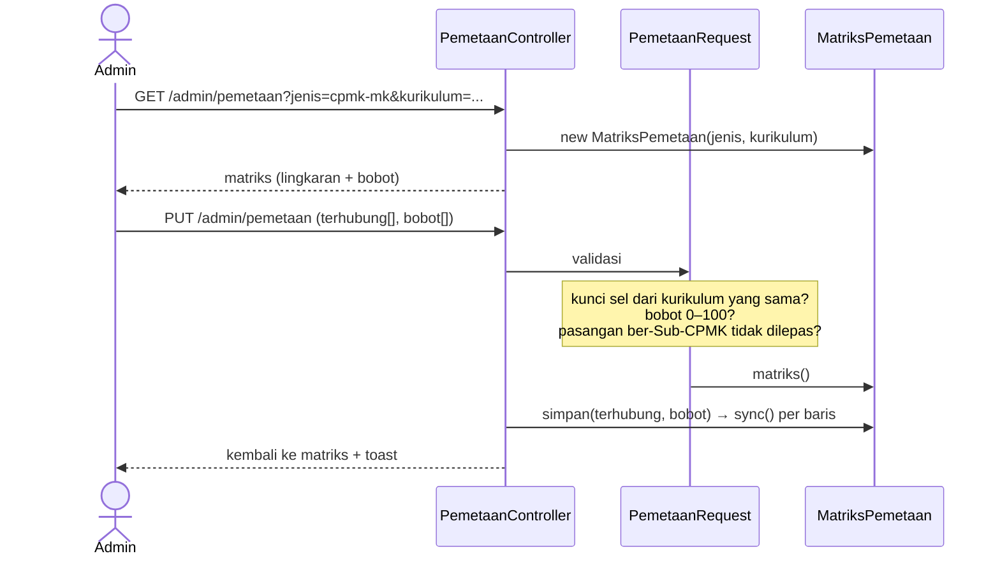

# 03 · Pemetaan Kurikulum, Sub-CPMK, dan Data Kurikulum Koprodi

Catatan iterasi 3 (bagian 11 spesifikasi). Dibaca setelah [02-data-master.md](02-data-master.md).

## 1. Tujuan dan kebutuhan yang dipenuhi

- **Pemetaan kurikulum.** Admin memetakan komponen kurikulum lewat matriks: CPL–Profil Lulusan,
  CPL–Bahan Kajian, Bahan Kajian–Mata Kuliah (dengan bobot), dan CPMK–Mata Kuliah (dengan bobot).
- **Sub-CPMK.** Admin mengelola Sub-CPMK, yang menempel ke pasangan CPMK–MK hasil pemetaan. Rincian
  penilaiannya (metode, teknik, instrumen, kriteria) dikelola di halaman detail Sub-CPMK.
- **Ringkasan bobot.** Detail Mata Kuliah menampilkan ringkasan bobot CPMK dan Sub-CPMK, mirip
  Tabel 19 APTIKOM.
- **Data Kurikulum Koprodi.** Koprodi melihat data kurikulum, evaluasi, dan matriks pemetaan secara
  read-only.

Kebutuhan yang dipenuhi:

- **KF-03:** data master Sub-CPMK, yang dipindah dari iterasi 2 (KD-35).
- **KF-04:** kelola pemetaan kurikulum.
- **KF-12 (sebagian):** Koprodi melihat data kurikulum.
- **Skenario uji bagian 12:** nomor 5 (Admin menyimpan pemetaan).

## 2. File yang dibuat atau diubah

| File | Peran |
|---|---|
| `app/Services/MatriksPemetaan.php` | Menyusun baris, kolom, dan sel matriks untuk satu jenis pemetaan, serta menyimpannya |
| `app/Http/Controllers/Admin/PemetaanController.php`, `app/Http/Requests/Admin/PemetaanRequest.php` | Halaman matriks Admin dan validasinya |
| `resources/views/components/matriks-pemetaan.blade.php` | Tampilan matriks, bisa diubah atau read-only |
| `app/Http/Controllers/Admin/SubCpmkController.php`, `SubCpmkPenilaianController.php` | Sub-CPMK dan rincian penilaiannya |
| `app/Http/Requests/Admin/SubCpmkRequest.php`, `SubCpmkPenilaianRequest.php` | Validasi Sub-CPMK dan rincian penilaian |
| `resources/views/admin/sub-cpmk/*` | Daftar, form, detail, dan ubah rincian penilaian |
| `app/Http/Controllers/Admin/MataKuliahController.php` (`show`) | Detail mata kuliah |
| `resources/views/components/ringkasan-bobot-mk.blade.php` | Ringkasan bobot CPMK dan Sub-CPMK satu MK |
| `app/Http/Controllers/Koprodi/DataKurikulumController.php`, `resources/views/koprodi/*` | Data Kurikulum Koprodi |
| `resources/views/components/tab.blade.php`, `peringatan.blade.php` | Komponen tab dan kotak peringatan kuning |
| `app/Support/Angka.php` | Format angka berkoma desimal dan perbandingan bobot |
| `app/Models/PemetaanCpmkMk.php`, `MataKuliah.php`, `SubCpmk.php` | `label()`, total bobot, relasi `penilaian`, dan pengecekan hapus |
| `database/seeders/PemetaanDemoSeeder.php` | Data contoh pemetaan dan Sub-CPMK |
| `tests/Feature/Admin/PemetaanKurikulumTest.php`, `SubCpmkTest.php`, `tests/Feature/Koprodi/DataKurikulumTest.php` | Test iterasi ini |

## 3. Alur kerja



Setelah pemetaan CPMK–MK tersimpan, Admin membuat Sub-CPMK untuk setiap pasangan, lalu mengisi rincian
penilaiannya di halaman detail Sub-CPMK.

## 4. Penjelasan potongan kode penting

### a. Satu class untuk keempat matriks

```php
$this->daftarBaris = match ($jenis) {
    'cpl-pl', 'cpl-bk' => $kurikulum->cpl()->with($relasi)->orderBy('kode_cpl')->get(),
    'bk-mk' => $kurikulum->bahanKajian()->with($relasi)->orderBy('kode_bk')->get(),
    'cpmk-mk' => Cpmk::with(['cpl', $relasi])->whereHas('cpl', ...)->orderBy('kode_cpmk')->get(),
};
```

- **Pilihan per jenis.** Ekspresi `match` memilih data baris, data kolom, nama relasi
  (`profilLulusan`, `bahanKajian`, `mataKuliah`), dan kolom bobot pivot sesuai jenis pemetaan.
- **Satu cara tampil dan simpan.** Karena keempat jenis disusun dengan bentuk yang sama, view dan
  proses simpan cukup ditulis sekali.
- **Kunci sel.** Setiap sel diberi kunci `"<id baris>|<id kolom>"`, mis.
  `"0192…|0193…"`. Kunci itu dikirim lewat `terhubung[]`.

### b. Menyimpan dengan `sync()`

```php
foreach ($this->daftarBaris as $baris) {
    // [id kolom => [kolom bobot => nilai]] untuk sel yang dicentang
    $baris->{$this->relasi()}()->sync($dataPivot);
}
```

- **Cara kerja `sync()`.** Pasangan baru ditambah, bobot pasangan lama diperbarui, dan pasangan yang
  tidak dicentang dilepas.
- **UUID tetap terisi.** Relasinya memakai model pivot (`->using(...)`), jadi PK UUID baris pivot
  baru tetap terisi (catatan 01, bagian 4b).
- **Satu transaksi.** Semuanya dijalankan dalam `DB::transaction`, sehingga matriks tersimpan utuh
  atau tidak sama sekali.

### c. Validasi pasangan

```php
if (! $matriks->kunciValid($kunci)) {
    $validator->errors()->add('terhubung', 'Pemetaan hanya boleh menghubungkan data dari kurikulum yang sama.');
}
...
$pasanganTerkunci = $matriks->pasanganTerkunci($kunciDipilih);
```

- **Kurikulum yang sama.** `kunciValid()` memeriksa bahwa id baris dan kolom ada di matriks kurikulum
  itu (bagian 6).
- **Pasangan yang terkunci.** `pasanganTerkunci()` mencari pasangan CPMK–MK yang akan dilepas padahal
  sudah punya Sub-CPMK. Jika ada, penyimpanan ditolak (KD-20, KD-54).

### d. Isian bobot hanya untuk sel terhubung

```blade
<input type="checkbox" name="terhubung[]" value="{{ $kunci }}" x-model="terhubung">
<input name="bobot[{{ $kunci }}]" x-show="terhubung" x-bind:disabled="! terhubung">
```

- **Isian ikut lingkaran.** Alpine.js menampilkan dan mengaktifkan isian bobot hanya saat lingkarannya
  dicentang.
- **Hanya yang aktif terkirim.** Isian yang `disabled` tidak ikut dikirim browser, jadi matriks besar
  tetap aman dari batas jumlah isian PHP (KD-55).

### e. Ringkasan bobot mata kuliah

```php
public function totalBobotCpmk(): float          // MataKuliah
{
    return (float) $this->pemetaanCpmkMk->sum('bobot_cpmk');
}

public function totalBobotSubCpmk(): float       // PemetaanCpmkMk
{
    return (float) $this->subCpmk->sum('bobot_sub_cpmk');
}
```

- **Komponen bersama.** `x-ringkasan-bobot-mk` membandingkan kedua total dengan targetnya memakai
  `Angka::sama()` (selisih < 0,005). Komponen ini dipakai di detail MK Admin dan tab Mata Kuliah
  Koprodi.
- **Dua target.** Σ bobot Sub-CPMK harus sama dengan bobot CPMK-nya, dan Σ bobot CPMK per MK harus
  100.
- **Hanya peringatan.** Jika tidak sesuai, tampil peringatan kuning, tanpa memblokir (bagian 6).

## 5. Hubungan dengan proposal dan spesifikasi

- **ERD kelompok C:** tabel pemetaan (`pemetaan_cpl_pl`, `pemetaan_cpl_bk`, `pemetaan_bk_mk`,
  `pemetaan_cpmk_mk`) dan `sub_cpmk`/`sub_cpmk_penilaian` dipakai sesuai ERD.
- **Bagian 5.1:** `bobot_cpmk` adalah target "skor maks CPMK" (Tabel 19 APTIKOM), dan
  `bobot_sub_cpmk` target Sub-CPMK. Keduanya hanya untuk validasi dan tampilan. Perhitungan
  (iterasi 7) memakai bobot rencana asesmen kelas.
- **Contoh APTIKOM:**
  - CPMK032 kurikulum 2021 dipetakan ke dua MK (Basis Data dan Pemrograman Web), seperti CPMK063 di
    MK04 dan MK34;
  - kode Sub-CPMK0321 dipakai di dua pasangan, seperti Sub-CPMK0811 di Tabel 15.
- **Antarmuka:** matriks mengikuti Gambar 3.10. Lingkaran terisi biru berarti terhubung. Kolom
  pertama dan baris judul menempel, dan tombol Simpan Pemetaan menempel di bawah layar pada mobile
  (bagian 7.4).

## 6. Konsep Laravel yang muncul

- **`sync()` dengan data pivot:** `->sync([$id => ['bobot_cpmk' => 40]])`.
- **`Rule::exists()->where(fn)` dengan subquery:** memastikan pasangan CPMK–MK berasal dari
  kurikulum yang sama.
- **Join pada Eloquent (`->join()` + `select('sub_cpmk.*')`):** mengurutkan Sub-CPMK berdasarkan
  kode MK dan kode CPMK dari tabel lain.
- **Single action controller (`__invoke`):** controller dengan satu aksi, mis.
  `DataKurikulumController`.
- **`@use` di Blade:** memakai class (mis. `Angka`) di view tanpa menulis namespace lengkap.
- **Alpine `x-model` pada checkbox:** menyimpan status centang sebagai `true`/`false`.
- **Elemen `<details>`:** bagian yang bisa dibuka-tutup tanpa JavaScript.

## 7. Cara mencoba dan menjalankan test

Setelah `php artisan migrate:fresh --seed`:

1. **Matriks pemetaan.** Login sebagai Admin, lalu buka menu Pemetaan Kurikulum dan pilih jenis
   CPMK – Mata Kuliah. Total bobot setiap MK adalah 100.
2. **Peringatan total bobot.** Ubah salah satu bobot menjadi 30, lalu simpan. Baris Total menjadi
   kuning.
3. **Pasangan terkunci.** Lepas lingkaran CPMK021 · INF101, lalu simpan. Penyimpanan ditolak karena
   pasangan itu sudah punya Sub-CPMK.
4. **Sub-CPMK.** Buka Data Master → Sub-CPMK → ikon mata. Tambahkan rincian penilaian dengan metode
   Praktikum.
5. **Detail MK.** Buka Data Master → Mata Kuliah → ikon mata pada INF101 untuk melihat ringkasan
   bobot.
6. **Koprodi.** Login sebagai `koprodi@simonev.test` / `koprodi123`, lalu buka Data Kurikulum. Coba
   setiap tab; tidak ada tombol ubah atau hapus.

```bash
php artisan test --filter='Pemetaan|SubCpmk|DataKurikulum'
```

## 8. Ringkasan iterasi

- **Tanggal:** 30 Oktober 2026.
- **Hasil test:** 188 test lulus (32 di antaranya baru), dan Pint bersih.
- **Tampilan:** matriks CPMK–MK dan CPL–PL, daftar dan detail Sub-CPMK, detail MK, serta tab Data
  Kurikulum Koprodi sudah dicek di lebar 360, 768, dan 1280px.
- **Kendala:**
  - Matriks read-only Koprodi sempat membuat halaman bergeser horizontal di 360px. Penyebabnya, teks
    `sr-only` (posisinya absolut) keluar dari wadah yang bisa digeser. Wadahnya kini diberi `relative`.
  - Tabel ringkasan bobot di 360px sempat perlu digeser. Deskripsi kini pindah ke bawah kode di
    layar kecil.
- **Perlu diputuskan:** tidak ada keputusan baru dari user. KD-54 sampai KD-56 adalah keputusan
  teknis.

## 9. Pertanyaan yang mungkin diajukan penguji

1. **Mengapa Sub-CPMK menempel ke pasangan CPMK–MK, bukan ke CPMK?**
   CPMK yang sama bisa dipakai di beberapa MK dengan Sub-CPMK, materi, dan bobot yang berbeda (bagian
   4 spesifikasi). Pasangan CPMK–MK adalah tempat yang tepat untuk menyimpan perbedaan itu.
2. **Apa arti bobot di matriks CPMK–Mata Kuliah?**
   Skor maksimum CPMK dalam MK (Tabel 19 APTIKOM). Bobot ini hanya target. Perhitungan capaian
   memakai bobot rencana asesmen kelas, supaya revisi kurikulum tidak mengubah hasil lama (KD-08).
3. **Bagaimana sistem mencegah pemetaan antarkurikulum?**
   Matriks disusun per kurikulum, dan setiap kunci sel yang dikirim diperiksa ulang di server dengan
   `kunciValid()`.
4. **Mengapa pasangan CPMK–MK yang sudah punya Sub-CPMK tidak bisa dilepas?**
   Sub-CPMK dan bobot kontribusi kelas bergantung padanya. Melepasnya akan menghapus data
   perhitungan lama.
5. **Apakah Koprodi bisa mengubah kurikulum?**
   Tidak. Halaman Koprodi hanya menampilkan data, dan semua route ubah ada di grup `/admin` dengan
   middleware `peran:ADMIN`, sehingga Koprodi mendapat 403.
