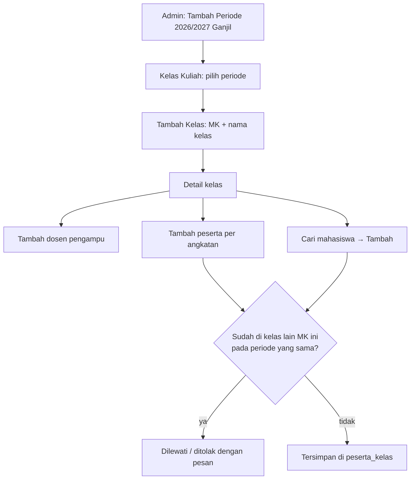

# 04 · Periode Akademik dan Kelas Kuliah

Catatan iterasi 4 (bagian 11 spesifikasi). Dibaca setelah [03-pemetaan-kurikulum.md](03-pemetaan-kurikulum.md).

## 1. Tujuan dan kebutuhan yang dipenuhi

Admin menyiapkan pelaksanaan perkuliahan:

- **Periode akademik:** tahun akademik + semester Ganjil/Genap.
- **Kelas kuliah:** satu mata kuliah pada satu periode, mis. "INF101 Matematika Diskrit – A". Kelas
  boleh berasal dari kurikulum mana pun, karena kelas kurikulum lama dan baru bisa berjalan
  bersamaan.
- **Dosen pengampu:** boleh lebih dari satu per kelas.
- **Peserta kelas:** ditambahkan lewat pencarian mahasiswa atau sekaligus per angkatan.

Kebutuhan yang dipenuhi:

- **KF-05:** kelola periode akademik dan kelas kuliah.
- **KF-06:** tentukan dosen pengampu dan peserta kelas.
- **Skenario uji bagian 12:** nomor 6 (Admin membuat kelas dan menentukan dosen/peserta).

## 2. File yang dibuat atau diubah

| File | Peran |
|---|---|
| `app/Http/Controllers/Admin/PeriodeAkademikController.php`, `app/Http/Requests/Admin/PeriodeAkademikRequest.php` | CRUD periode dan validasi format/duplikasi |
| `app/Http/Controllers/Admin/KelasKuliahController.php`, `app/Http/Requests/Admin/KelasKuliahRequest.php` | Daftar kelas per periode, tambah/ubah/hapus, dan detail kelas |
| `app/Http/Controllers/Admin/DosenPengampuController.php`, `DosenPengampuRequest.php` | Menambah dan mengeluarkan dosen pengampu |
| `app/Http/Controllers/Admin/PesertaKelasController.php`, `PesertaKelasRequest.php` | Menambah satu peserta dan mengeluarkan peserta |
| `app/Http/Controllers/Admin/PesertaPerAngkatanController.php`, `PesertaPerAngkatanRequest.php` | Menambah semua mahasiswa satu angkatan |
| `app/Models/KelasKuliah.php` | `nama()`, `scopeCari()`, `kelasLainYangDiikuti()`, `bisaGantiMataKuliahDanPeriode()`, `alasanTidakBisaDihapus()` |
| `app/Models/PeriodeAkademik.php`, `PesertaKelas.php` | Pengecekan hapus |
| `app/Http/Controllers/Controller.php` | `periodeTerpilih()` |
| `resources/views/admin/periode-akademik/*`, `resources/views/admin/kelas-kuliah/*` | Halaman periode, daftar kelas, form, dan detail kelas |
| `resources/views/components/alat-daftar.blade.php` | Tambahan dropdown Periode |
| `database/seeders/PerkuliahanDemoSeeder.php` | Data contoh periode dan kelas |
| `tests/Feature/Admin/PerkuliahanTest.php` | Test iterasi ini |

## 3. Alur kerja



## 4. Penjelasan potongan kode penting

### a. Satu kelas per MK per periode (KD-37)

```php
public function kelasLainYangDiikuti(Mahasiswa $mahasiswa): ?self
{
    return self::where('mata_kuliah_id', $this->mata_kuliah_id)
        ->where('periode_akademik_id', $this->periode_akademik_id)
        ->whereKeyNot($this->getKey())
        ->whereHas('pesertaKelas', fn (Builder $query) => $query->where('mahasiswa_id', $mahasiswa->mahasiswa_id))
        ->first();
}
```

- **Yang dicari.** Kelas lain dengan MK dan periode yang sama, tempat mahasiswa itu sudah terdaftar.
- **Jika ditemukan.** `PesertaKelasRequest` menolak dengan pesan "Mahasiswa ini sudah terdaftar di
  kelas B …".
- **Alasannya.** Aturan MK yang diulang (KD-24) memilih kelas terbaru. Jika ada dua kelas dalam satu
  periode, kelas terbaru tidak punya jawaban tunggal. Mahasiswa tetap boleh mengulang MK di periode
  lain.

### b. Tambah per angkatan yang melewati duplikat

```php
$belumTerdaftar = Mahasiswa::where('angkatan', $angkatan)
    ->whereDoesntHave('kelasKuliah', fn (Builder $query) => $query
        ->where('mata_kuliah_id', $kelasKuliah->mata_kuliah_id)
        ->where('periode_akademik_id', $kelasKuliah->periode_akademik_id))
    ->pluck('mahasiswa_id');

$kelasKuliah->mahasiswa()->attach($belumTerdaftar);
```

- **`whereDoesntHave`.** Membuang mahasiswa yang sudah punya kelas untuk MK dan periode yang sama,
  baik di kelas ini maupun kelas paralel.
- **`attach()` dengan model pivot.** Menambah banyak baris `peserta_kelas` sekaligus, masing-masing
  dengan PK UUID.
- **Pesan hasil.** Pesan sukses menyebut jumlah yang ditambahkan dan yang dilewati (KD-59).

### c. Duplikasi periode dan kelas dicek di aplikasi

ERD tidak memberi tanda UQ untuk periode (tahun + semester) dan kelas (MK + periode + nama kelas).
Karena itu duplikasinya dicek di method `after()` Form Request (bagian 6):

```php
$sudahAda = KelasKuliah::where('mata_kuliah_id', $this->input('mata_kuliah_id'))
    ->where('periode_akademik_id', $this->input('periode_akademik_id'))
    ->where('nama_kelas', $this->input('nama_kelas'))
    ->when($kelas, fn ($query) => $query->whereKeyNot($kelas->getKey()))
    ->exists();
```

`when($kelas, ...)` hanya menambahkan kondisi saat mengubah kelas, supaya kelas itu sendiri tidak
dianggap duplikat.

### d. Urutan periode terbaru

```php
$query->orderByDesc('tahun_akademik')
    ->orderByRaw("FIELD(semester_periode, 'Genap', 'Ganjil')");
```

- **Urutan.** Tahun akademik terbesar didahulukan. Di tahun yang sama, Genap didahulukan karena
  berjalan setelah Ganjil (bagian 4).
- **`FIELD()`.** Fungsi MySQL ini memberi urutan sesuai daftar yang ditulis.
- **Periode aktif.** `PeriodeAkademik::aktif()` mengambil periode pertama dari urutan ini yang sudah
  punya kelas.

## 5. Hubungan dengan proposal dan spesifikasi

- **ERD kelompok D:** `periode_akademik`, `kelas_kuliah`, `dosen_kelas`, dan `peserta_kelas`.
- **Aturan hapus (KD-20):** dosen pengampu dan peserta ikut terhapus jika kelasnya dihapus. Namun:
  - kelas yang sudah punya rencana asesmen tidak bisa dihapus;
  - peserta yang sudah punya nilai tidak bisa dikeluarkan.
- **Bagian 13:** periode aktif adalah periode terbaru yang sudah memiliki kelas, dipakai di Beranda
  Admin dan halaman Kelas Kuliah.
- **Antarmuka (Gambar 3.11):** halaman kelas berisi dropdown Periode Akademik, tombol Tambah Kelas,
  dan tabel Mata Kuliah, Kelas, Dosen, Peserta, Aksi.

## 6. Konsep Laravel yang muncul

- **`whereHas` / `whereDoesntHave`:** menyaring berdasarkan ada tidaknya data di relasi.
- **`withCount('pesertaKelas')`:** menghitung jumlah relasi tanpa memuat datanya, tersedia sebagai
  `peserta_kelas_count`.
- **`select('kelas_kuliah.*')` sebelum `withCount`:** saat memakai join, kolom tabel utama dipilih
  dulu, baru hitungan relasi ditambahkan.
- **`attach()`, `detach()`, dan `syncWithoutDetaching()`:**
  - `attach()` menambah baris pivot;
  - `detach()` menghapusnya;
  - `syncWithoutDetaching()` (dipakai di seeder) menambah tanpa menghapus yang lama.
- **`bail`:** menghentikan validasi satu isian setelah aturan pertama gagal. Dipakai agar pengecekan
  "dua tahun berurutan" tidak dijalankan jika format tahun sudah salah.

## 7. Cara mencoba dan menjalankan test

Setelah `php artisan migrate:fresh --seed`, login sebagai Admin, lalu:

1. **Periode.** Buka Perkuliahan → Periode Akademik. 2026/2027 Ganjil bertanda "Aktif".
2. **Daftar kelas.** Buka Perkuliahan → Kelas Kuliah. Terlihat empat kelas periode aktif. Ganti
   dropdown ke 2025/2026 Genap untuk melihat kelas Struktur Data.
3. **Kelas baru.** Tambah kelas INF101 kelas B, lalu tambah peserta per angkatan 2026. Kedelapan
   mahasiswa dilewati karena sudah di kelas A.
4. **Cari mahasiswa.** Di detail kelas INF101 A, cari "Putra". Yang muncul hanya mahasiswa yang belum
   mengikuti MK ini pada periode ini.

```bash
php artisan test --filter=PerkuliahanTest
```

## 8. Ringkasan iterasi

- **Tanggal:** 30 Oktober 2026.
- **Hasil test:** 205 test lulus (17 di antaranya baru), dan Pint bersih.
- **Tampilan:** Periode Akademik, Kelas Kuliah, form kelas, detail kelas dengan hasil pencarian, dan
  Beranda Admin sudah dicek di 360, 768, dan 1280px tanpa geser horizontal.
- **Kendala:**
  - Tahun acak `PeriodeAkademikFactory` (2020–2030) bisa lebih baru dari periode yang ditulis di
    test, sehingga periode aktif berubah-ubah. Rentangnya diubah menjadi 2000–2019.
  - Validasi tahun akademik sempat error saat formatnya salah, karena pengecekan tahun berurutan tetap
    berjalan. Aturan `bail` menghentikannya.
- **Perlu diputuskan:** tidak ada keputusan baru dari user. KD-57 sampai KD-59 adalah keputusan
  teknis.

## 9. Pertanyaan yang mungkin diajukan penguji

1. **Mengapa mahasiswa tidak boleh di dua kelas paralel untuk MK yang sama?**
   Capaian CPL memakai satu kelas per MK, yaitu kelas terbaru yang sudah bernilai (KD-24). Dua kelas
   dalam satu periode membuat pilihan kelas itu tidak jelas (KD-37).
2. **Bagaimana jika mahasiswa mengulang mata kuliah?**
   Ia didaftarkan ke kelas MK yang sama di periode berikutnya. Itu diperbolehkan, dan perhitungannya
   diatur di iterasi 7.
3. **Mengapa peserta yang sudah punya nilai tidak bisa dikeluarkan?**
   Nilainya akan ikut hilang dan capaian kelas berubah. Foreign key `nilai_asesmen.peserta_kelas_id`
   bersifat restrict, dan aplikasi menampilkan pesannya lebih dulu.
4. **Bagaimana periode aktif ditentukan?**
   Dari periode terbaru (tahun akademik terbesar, Genap setelah Ganjil) yang sudah memiliki kelas.
   ERD tidak punya kolom status aktif (bagian 13).
