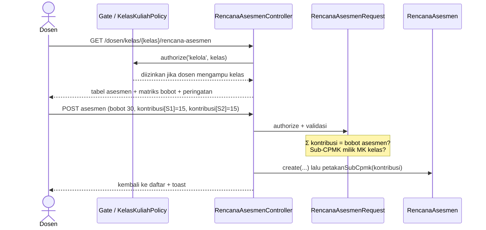

# 05 · Rencana Asesmen, Dashboard Dosen, dan Mata Kuliah Dosen

Catatan iterasi 5 (bagian 11 spesifikasi). Dibaca setelah [04-perkuliahan.md](04-perkuliahan.md).

## 1. Tujuan dan kebutuhan yang dipenuhi

Dosen menyiapkan penilaian kelas yang ia ampu:

- **Rencana asesmen:** metode, nama, bobot, nilai maksimum, dan tanggal.
- **Pemetaan asesmen ke Sub-CPMK:** setiap pasangan diberi bobot kontribusi dalam % nilai akhir MK.
  Bobot kontribusi ini adalah dasar perhitungan capaian (bagian 5.1).
- **Matriks bobot:** seperti bagian Penilaian RPS APTIKOM, lengkap dengan peringatan.
- **Dashboard Dosen** dan **halaman Mata Kuliah** (CPL, CPMK, Sub-CPMK terkait).

Kebutuhan yang dipenuhi:

- **KF-07:** dosen melihat CPL, CPMK, dan Sub-CPMK mata kuliahnya.
- **KF-08:** kelola rencana asesmen.
- **KF-09:** petakan asesmen ke Sub-CPMK beserta bobot kontribusinya.
- **Bagian 6:** dosen hanya bisa membuka kelas yang ia ampu (Policy).
- **Skenario uji bagian 12:** nomor 7 (rencana asesmen tersimpan) dan 8 (hubungan asesmen–Sub-CPMK
  tersimpan).

## 2. File yang dibuat atau diubah

| File | Peran |
|---|---|
| `app/Policies/KelasKuliahPolicy.php`, `MataKuliahPolicy.php` | Dosen hanya untuk kelas/MK yang diampu |
| `app/Http/Controllers/Dosen/RencanaAsesmenController.php` | Daftar, tambah, ubah, dan hapus asesmen satu kelas |
| `app/Http/Requests/Dosen/RencanaAsesmenRequest.php` | Validasi bobot, nilai maksimum, dan Sub-CPMK |
| `app/Services/MatriksBobotKelas.php` | Matriks Sub-CPMK × asesmen dan peringatan bobot |
| `app/Http/Controllers/Dosen/DashboardDosenController.php`, `KelasDiampuController.php`, `MataKuliahDosenController.php` | Dashboard, daftar kelas untuk rencana asesmen, Mata Kuliah Dosen |
| `app/Models/RencanaAsesmen.php` | `petakanSubCpmk()`, `nilaiTertinggi()`, `alasanTidakBisaDihapus()` |
| `app/Models/KelasKuliah.php` | `daftarSubCpmk()`: Sub-CPMK milik MK kelas |
| `resources/views/dosen/*` | Halaman-halaman Dosen |
| `resources/js/app.js` | `formAsesmen`: penghitung Σ kontribusi langsung |
| `resources/views/components/sidebar.blade.php`, `config/menu.php` | Menu Dosen; pola menu aktif boleh berupa daftar |
| `database/seeders/AsesmenDemoSeeder.php` | Rencana asesmen contoh |
| `tests/Feature/Dosen/*` | Test iterasi ini |

## 3. Alur kerja



## 4. Penjelasan potongan kode penting

### a. Policy

```php
public function kelola(User $user, KelasKuliah $kelasKuliah): bool
{
    return $user->dosen !== null
        && $kelasKuliah->dosen()->whereKey($user->dosen->dosen_id)->exists();
}
```

- **Lapisan kedua.** Middleware `peran:DOSEN` hanya memastikan peran aktif. Policy memastikan dosen
  ini memang terdaftar di `dosen_kelas` kelas tersebut.
- **Pemanggilan.** Controller memanggil `Gate::authorize('kelola', $kelasKuliah)`; jika hasilnya
  `false`, Laravel menampilkan 403.
- **Dicari otomatis.** Laravel menemukan `KelasKuliahPolicy` untuk model `KelasKuliah` dari nama
  class-nya, tanpa pendaftaran manual.

### b. Validasi Σ kontribusi = bobot asesmen

```php
$totalKontribusi = array_sum($kontribusi);

if (! Angka::sama($totalKontribusi, $this->input('bobot_asesmen'))) {
    $validator->errors()->add('kontribusi', 'Jumlah bobot kontribusi (...) harus sama dengan bobot asesmen (...).');
}
```

- **Bentuk isian.** `kontribusi` berbentuk `[id Sub-CPMK => bobot]`, dikirim hanya untuk Sub-CPMK yang
  dicentang.
- **Toleransi.** `Angka::sama()` membandingkan dengan toleransi 0,005 karena bobot disimpan dua
  desimal.
- **Sub-CPMK yang boleh.** Sebelum menjumlahkan, request memastikan semua id Sub-CPMK milik MK kelas
  ini (`$kelas->daftarSubCpmk()`).

### c. Menyimpan pemetaan asesmen–Sub-CPMK

```php
public function petakanSubCpmk(array $kontribusi): void
{
    $this->subCpmk()->sync(
        collect($kontribusi)->map(fn ($bobot) => ['bobot_kontribusi' => $bobot])->all()
    );
}
```

`sync()` memakai model pivot `RencanaAsesmenSubCpmk`, jadi PK UUID terisi. Saat asesmen diubah,
Sub-CPMK yang tidak dicentang lagi ikut dilepas.

### d. Peringatan bobot

```php
foreach ($subCpmkPerId as $subCpmk) {
    $total = $this->totalSubCpmk($subCpmk);   // Σ bobot_kontribusi ke Sub-CPMK ini di kelas ini

    if (! Angka::sama($total, $subCpmk->bobot_sub_cpmk)) {
        $daftarPeringatan[] = "Bobot kontribusi ke {$subCpmk->kode_sub_cpmk} di kelas ini ..."
    }
}
```

- **Target hanya pembanding.** `bobot_sub_cpmk` di kurikulum adalah target (KD-08). Jika target
  direvisi, kelas yang sudah berjalan tidak berubah dan hanya mendapat peringatan (Uji 5 bagian 5.5).
- **Tiga peringatan.** `MatriksBobotKelas::peringatan()` juga memeriksa Σ bobot asesmen ≠ 100 dan
  metode asesmen yang tidak direncanakan di `sub_cpmk_penilaian`.
- **Tidak memblokir.** Peringatan tidak menghalangi penyimpanan (bagian 6).

### e. Penghitung kontribusi di browser

```js
get totalKontribusi() {
    return Object.values(this.subCpmk)
        .filter((baris) => baris.dipilih)
        .reduce((jumlah, baris) => jumlah + this.angka(baris.kontribusi), 0);
},
```

- **Bantuan, bukan pengaman.** Alpine menghitung jumlah kontribusi yang dicentang setiap kali isian
  berubah. Teks menjadi hijau jika jumlahnya sudah sama dengan bobot asesmen.
- **Tetap dicek di server.** Pemeriksaan sebenarnya ada di `RencanaAsesmenRequest`.

## 5. Hubungan dengan proposal dan spesifikasi

- **ERD kelompok E:** `rencana_asesmen` dan `rencana_asesmen_sub_cpmk` (`bobot_kontribusi`).
- **Bagian 5.1:**
  - `bobot_kontribusi` adalah satu sel matriks RPS di kelas itu dan menjadi dasar semua bobot di
    rumus 5.2;
  - `bobot_asesmen` adalah total satu kolom;
  - `bobot_sub_cpmk` adalah target satu baris.
- **Bagian 6:**
  - nilai maksimum > 0;
  - Σ kontribusi = bobot asesmen (diblokir);
  - Sub-CPMK harus milik MK kelas;
  - tiga peringatan yang tidak memblokir.
- **Antarmuka (Gambar 3.12):**
  - tiga kartu info (Mata Kuliah, Kelas, Periode) dan tombol Tambah Asesmen;
  - tabel Asesmen, Metode, Bobot (%), Sub-CPMK, Nilai Maks, Tanggal, Aksi;
  - matriks bobot di bawahnya.

## 6. Konsep Laravel yang muncul

- **Policy dan Gate:** `Gate::authorize('kelola', $kelas)` di controller, dan
  `$this->user()->can('kelola', ...)` di `authorize()` Form Request.
- **Nested resource route:** `Route::resource('kelas.rencana-asesmen', ...)` menghasilkan alamat
  `/dosen/kelas/{kelasKuliah}/rencana-asesmen/{rencanaAsesmen}`.
- **`prepareForValidation()`:** mengubah koma desimal menjadi titik sebelum validasi.
- **Aturan `min:` dinamis:** `'min:'.$nilaiTertinggi` hanya ditambahkan jika asesmen sudah punya
  nilai.
- **`Alpine.data()` dengan getter:** data form yang dihitung ulang otomatis (`totalKontribusi`,
  `sesuai`).

## 7. Cara mencoba dan menjalankan test

Setelah `php artisan migrate:fresh --seed`, login sebagai `dosen@simonev.test` / `dosen123`:

1. **Dashboard.** Tampil kartu kelas INF202 dan INF102 periode 2026/2027 Ganjil.
2. **Rencana asesmen.** Buka Asesmen → Rencana Asesmen → Kelola pada INF102. Matriks bobot berisi
   total 100 tanpa peringatan.
3. **Asesmen tambahan.** Tambah asesmen "Kuis 2" berbobot 5 untuk Sub-CPMK0411. Muncul peringatan
   total bobot 105% dan Sub-CPMK0411 di atas target.
4. **Jumlah tidak sama.** Coba simpan asesmen dengan jumlah kontribusi berbeda dari bobotnya. Form
   menolak.
5. **Kelas orang lain.** Buka alamat rencana asesmen kelas INF101 (diampu dosen lain). Hasilnya 403.
6. **Mata kuliah.** Buka Mata Kuliah → ikon mata untuk melihat CPL, CPMK, dan Sub-CPMK.

```bash
php artisan test --filter='RencanaAsesmen|DashboardDanMataKuliahDosen'
```

## 8. Ringkasan iterasi

- **Tanggal:** 30 Oktober 2026.
- **Hasil test:** 225 test lulus (20 di antaranya baru), dan Pint bersih.
- **Tampilan:** Dashboard, daftar kelas, rencana asesmen dengan matriks, form asesmen, serta Mata
  Kuliah Dosen sudah dicek di 360, 768, dan 1280px tanpa geser horizontal.
- **Kendala:** tidak ada kendala berarti. Teks "(sudah sama)" pada form kosong sempat muncul padahal
  belum ada isian, lalu diperbaiki.
- **Perlu diputuskan:** tidak ada keputusan baru dari user. KD-60 sampai KD-62 adalah keputusan
  teknis.

## 9. Pertanyaan yang mungkin diajukan penguji

1. **Mengapa bobot kontribusi diisi per pasangan asesmen–Sub-CPMK?**
   Satu asesmen bisa mengukur beberapa Sub-CPMK, mis. UTS mengukur S1 dan S2. Bobot kontribusi adalah
   bagian nilai asesmen yang mengukur Sub-CPMK tertentu, sama seperti satu sel matriks penilaian RPS
   APTIKOM.
2. **Apa bedanya bobot kontribusi dengan bobot Sub-CPMK di kurikulum?**
   Bobot Sub-CPMK di kurikulum adalah target. Bobot kontribusi adalah yang benar-benar dipakai di
   kelas dan menjadi dasar perhitungan. Jika keduanya berbeda, sistem memberi peringatan (KD-08).
3. **Bagaimana dosen dicegah membuka kelas dosen lain?**
   Lewat `KelasKuliahPolicy`. Pemeriksaannya ada di server, jadi mengetik alamat kelas lain tetap
   menghasilkan 403.
4. **Mengapa Σ kontribusi ≠ bobot asesmen diblokir, sedangkan Σ bobot asesmen ≠ 100 hanya
   peringatan?**
   Kontribusi dan bobot asesmen diisi di form yang sama, jadi perbedaannya pasti salah ketik.
   Sebaliknya, total 100 baru tercapai setelah semua asesmen dimasukkan satu per satu (bagian 6).
