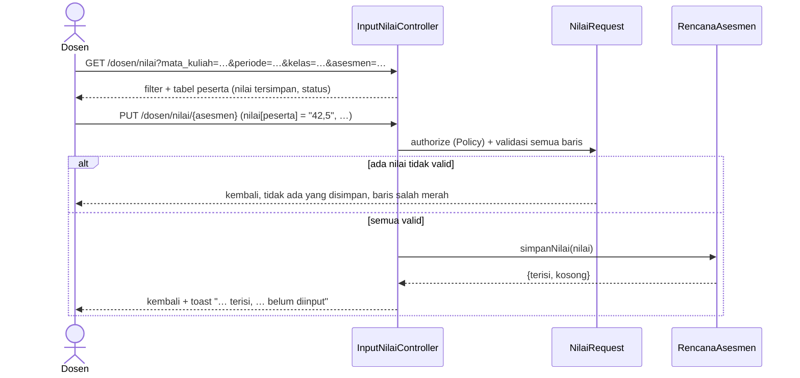

# 06 · Input Nilai Asesmen

Catatan iterasi 6 (bagian 11 spesifikasi). Dibaca setelah [05-rencana-asesmen.md](05-rencana-asesmen.md).

## 1. Tujuan dan kebutuhan yang dipenuhi

Dosen memasukkan nilai setiap peserta untuk satu asesmen. Inilah satu-satunya data yang diinput
dosen; capaian Sub-CPMK, CPMK, dan CPL nanti dihitung dari nilai ini (bagian 1 dan 5).

Kebutuhan yang dipenuhi:

- **KF-10:** input dan ubah nilai.
- **Bagian 6:** nilai numerik, 0 ≤ nilai ≤ nilai maksimum, dan hanya untuk peserta kelas itu.
- **Bagian 7.4:** tampilan mobile untuk input nilai.
- **Skenario uji bagian 12:** nomor 9 (nilai tersimpan) dan 10 (nilai di atas maksimum ditolak).

## 2. File yang dibuat atau diubah

| File | Peran |
|---|---|
| `app/Http/Controllers/Dosen/InputNilaiController.php` | Filter bertingkat (`edit`) dan simpan nilai (`update`) |
| `app/Http/Requests/Dosen/NilaiRequest.php` | Validasi seluruh nilai sekaligus |
| `app/Models/RencanaAsesmen.php` | `simpanNilai()`: simpan, perbarui, atau hapus nilai dalam satu transaksi |
| `resources/views/dosen/nilai/edit.blade.php` | Halaman Input Nilai |
| `resources/js/app.js` | `formNilai`: peringatan sebelum meninggalkan halaman |
| `resources/views/dosen/dashboard.blade.php`, `dosen/rencana-asesmen/index.blade.php` | Tautan ke Input Nilai |
| `database/seeders/NilaiDemoSeeder.php` | Nilai contoh |
| `tests/Feature/Dosen/InputNilaiTest.php` | Test iterasi ini |

## 3. Alur kerja



## 4. Penjelasan potongan kode penting

### a. Filter bertingkat

```php
$mataKuliahId = $this->pilihDari($daftarIdMataKuliah, $request->query('mata_kuliah'));
$kelasMataKuliah = $daftarKelasDiampu->where('mata_kuliah_id', $mataKuliahId);
$periodeId = $this->pilihDari($daftarIdPeriode, $request->query('periode'));
...
private function pilihDari(array $daftarId, mixed $dipilih): ?string
{
    if (is_string($dipilih) && in_array($dipilih, $daftarId, true)) {
        return $dipilih;
    }

    return count($daftarId) === 1 ? $daftarId[0] : null;
}
```

- **Pilihan disaring dari atas.** Setiap tingkat hanya berisi pilihan yang cocok dengan tingkat di
  atasnya, dan semuanya berasal dari kelas yang diampu dosen (`whereHas('dosen', ...)`).
- **Isian tidak cocok.** Jika dosen mengganti mata kuliah, kelas lama yang tidak cocok dibuang
  oleh `pilihDari()`.
- **Pilihan tunggal.** Tingkat yang hanya punya satu pilihan langsung dipilih (KD-63).

### b. Validasi semua baris sekaligus

```php
'nilai' => ['required', 'array'],
'nilai.*' => ['nullable', 'numeric', 'min:0', 'max:'.$this->route('rencanaAsesmen')->nilai_maksimum],
```

- **Aturan per baris.** Tanda `*` membuat aturan berlaku untuk setiap baris `nilai[id peserta]`.
- **Tidak ada yang tersimpan sebagian.** Jika satu baris gagal, Form Request langsung mengembalikan
  pengguna ke form beserta semua pesan error. `simpanNilai()` tidak pernah dipanggil, jadi tidak ada
  nilai yang tersimpan (bagian 7.6.8).
- **Koma desimal.** `prepareForValidation()` mengubah "42,5" menjadi "42.5" sebelum diperiksa.
- **Peserta kelas lain.** Method `after()` menolak id peserta yang bukan milik kelas asesmen itu.

### c. Simpan, perbarui, atau hapus

```php
if ($nilai === null || $nilai === '') {
    $this->nilaiAsesmen()->where('peserta_kelas_id', $pesertaKelasId)->delete();
    continue;
}

$this->nilaiAsesmen()->updateOrCreate(['peserta_kelas_id' => $pesertaKelasId], ['nilai' => $nilai]);
```

- **`updateOrCreate`.** Membuat baris nilai baru atau memperbarui yang sudah ada. Kunci
  `UQ(rencana_asesmen_id, peserta_kelas_id)` menjamin satu nilai per mahasiswa per asesmen.
- **Isian kosong.** Nilai yang dikosongkan dihapus, karena "belum diinput" berarti tidak ada barisnya
  (KD-29). Dengan begitu perhitungan iterasi 7 cukup melihat ada tidaknya baris nilai.

### d. Peringatan sebelum meninggalkan halaman

```js
Alpine.data('formNilai', () => ({
    berubah: false,
    init() {
        window.addEventListener('beforeunload', (event) => {
            if (this.berubah) { event.preventDefault(); event.returnValue = ''; }
        });
    },
}));
```

- **Menandai perubahan.** Form memasang `x-on:input="berubah = true"`.
- **Saat menyimpan.** `x-on:submit="berubah = false"` mematikan peringatan, karena perubahannya
  memang sedang disimpan.
- **Saat pergi.** Jika masih ada perubahan, peramban menampilkan konfirmasi bawaannya sebelum
  halaman ditinggalkan.

## 5. Hubungan dengan proposal dan spesifikasi

- **ERD:** `nilai_asesmen` dengan `UQ(rencana_asesmen_id, peserta_kelas_id)`.
- **Bagian 5.2 rumus 1:** nilai disimpan apa adanya (Nm). Normalisasi Na = Nm/Nmaks × 100 dilakukan
  saat perhitungan (iterasi 7), jadi asesmen berskala 50 atau 20 tetap benar.
- **Bagian 5.4:** nilai yang belum diinput tidak punya baris dan akan diabaikan dalam perhitungan.
- **Antarmuka (Gambar 3.13):**
  - dropdown bertingkat dan tombol utama Simpan Nilai;
  - tabel NPM, Nama Mahasiswa, Nilai, dan Status (badge hijau Tersimpan, abu Belum).

## 6. Konsep Laravel yang muncul

- **Validasi array dengan `nilai.*`** dan pesan per baris (`$errors->has('nilai.'.$id)`).
- **`old('nilai.'.$id, ...)`:** isian terakhir tetap tampil setelah validasi gagal.
- **`updateOrCreate`** pada relasi `hasMany`.
- **`$request->missing('mata_kuliah')`:** membedakan tautan langsung dari pengiriman form filter.
- **`$this->from(...)` di test:** mengatur halaman asal agar redirect validasi bisa diperiksa.

## 7. Cara mencoba dan menjalankan test

Setelah `php artisan migrate:fresh --seed`, login sebagai `dosen@simonev.test` / `dosen123`:

1. **Buka halaman.** Buka Asesmen → Input Nilai, lalu pilih INF102 → 2026/2027 Ganjil → Kelas A →
   UTS. Dua mahasiswa berstatus Belum.
2. **Isi nilai.** Isi "75,5" dan "80" untuk keduanya, lalu Simpan Nilai. Statusnya menjadi Tersimpan.
3. **Nilai terlalu besar.** Ubah satu nilai menjadi 150, lalu simpan. Muncul pesan merah dan tidak ada
   nilai yang berubah.
4. **Kosongkan nilai.** Kosongkan satu nilai, lalu simpan. Statusnya kembali Belum.
5. **Mobile.** Di layar kecil, panel filter bisa dibuka-tutup lewat tombol Filter.

```bash
php artisan test --filter=InputNilaiTest
```

## 8. Ringkasan iterasi

- **Tanggal:** 30 Oktober 2026.
- **Hasil test:** 236 test lulus (11 di antaranya baru), dan Pint bersih.
- **Tampilan:** Input Nilai (tanpa pilihan dan dengan asesmen terpilih) dan Dashboard Dosen sudah
  dicek di 360, 768, dan 1280px tanpa geser horizontal.
- **Kendala:**
  - Tautan langsung `?kelas=` sempat menimpa pilihan mata kuliah baru di form filter. Kini tautan
    langsung hanya dipakai jika `?mata_kuliah=` tidak dikirim.
  - Jumlah nilai contoh di test seeder sempat salah hitung, lalu diperbaiki dengan rincian per kelas.
- **Perlu diputuskan:** tidak ada keputusan baru dari user. KD-63 dan KD-64 adalah keputusan teknis.

## 9. Pertanyaan yang mungkin diajukan penguji

1. **Apa yang terjadi jika dosen memasukkan nilai di atas nilai maksimum?**
   Seluruh form ditolak dan tidak ada nilai yang disimpan. Baris yang salah ditandai merah dengan pesan
   "Nilai tidak boleh lebih dari nilai maksimum (…)" (skenario uji 10).
2. **Mengapa nilai yang dikosongkan dihapus, bukan disimpan 0?**
   Nol berarti mahasiswa mendapat nol, sedangkan kosong berarti belum dinilai. Bagian 5.4 meminta
   nilai yang belum diinput diabaikan, bukan dihitung 0 (KD-04, KD-29).
3. **Bagaimana dosen dicegah mengisi nilai kelas lain?**
   Lewat `KelasKuliahPolicy` di `NilaiRequest::authorize()`. Selain itu, id peserta yang dikirim
   dicek harus milik kelas asesmen itu.
4. **Mengapa nilai tidak langsung dinormalisasi ke 0–100 saat disimpan?**
   Supaya data yang tersimpan sama dengan nilai asli dosen. Normalisasi adalah rumus 1 perhitungan dan
   tempatnya di `CapaianService` (iterasi 7).
