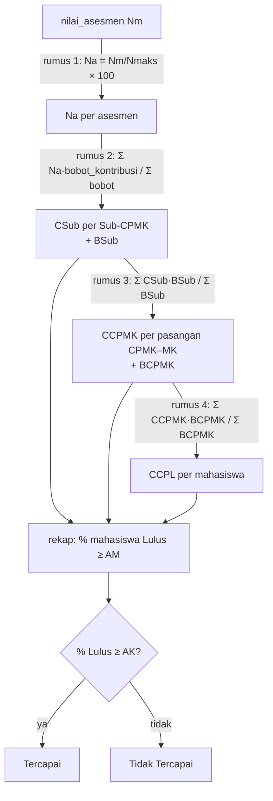

# 07 · Perhitungan Capaian (CapaianService)

Catatan iterasi 7 (bagian 11 spesifikasi). Dibaca setelah [06-input-nilai.md](06-input-nilai.md).
Ini bagian inti sistem: semua rumus capaian ada di `app/Services/CapaianService.php`.

## 1. Tujuan dan kebutuhan yang dipenuhi

Menghitung capaian Sub-CPMK, CPMK, dan CPL dari nilai asesmen, lalu menentukan status Lulus/Tercapai
memakai dua ambang dari `.env`.

Kebutuhan yang dipenuhi:

- **KF-11:** perhitungan capaian.
- **Bagian 5 spesifikasi:**
  - rumus 1–5 (5.2);
  - status dan agregat (5.3);
  - aturan teknis, termasuk nilai kosong, mahasiswa mengulang, dan dua kurikulum (5.4);
  - contoh uji 1–6 (5.5).
- **Skenario uji bagian 12:** nomor 11 (capaian terhitung dari nilai yang lengkap).

Dashboard, laporan, dan halaman mahasiswa (iterasi 8–9) hanya memanggil method service ini; tidak ada
rumus di controller atau view (bagian 14).

## 2. File yang dibuat atau diubah

| File | Peran |
|---|---|
| `app/Services/CapaianService.php` | Seluruh rumus capaian dan status |
| `app/Models/PeriodeAkademik.php` | `urutan()`: kunci urutan periode untuk aturan mengulang |
| `tests/Unit/CapaianServiceTest.php` | Uji 1–6 bagian 5.5 dan kasus tambahan |
| `tests/Support/MembangunDataCapaian.php` | Pembantu test untuk menyusun MK, kelas, asesmen, dan nilai |
| `tests/Feature/CapaianDataContohTest.php` | Capaian dari data contoh seeder (skenario uji 11) |

## 3. Alur perhitungan



Sebelum rumus 4 dihitung untuk banyak kelas, `pilihKelasPerMataKuliah()` memilih satu kelas per
mahasiswa per MK (aturan mengulang, bagian 5.4).

## 4. Penjelasan potongan kode penting

### a. Rumus 1 dan 2: dari nilai ke capaian Sub-CPMK

```php
$nilaiNormalisasi = $this->normalisasiNilai($nilai, $asesmen->nilai_maksimum); // Na = Nm/Nmaks × 100

foreach ($asesmen->subCpmk as $subCpmk) {
    $bobotKontribusi = (float) $subCpmk->pivot->bobot_kontribusi;
    $jumlahSubCpmk[$id]['jumlah'] += $nilaiNormalisasi * $bobotKontribusi;   // Σ Na × w
    $jumlahSubCpmk[$id]['bobot'] += $bobotKontribusi;                       // Σ w  (= BSub)
}
...
$capaianSub = $jumlah['jumlah'] / $jumlah['bobot'];                          // CSub
```

- **Bobot yang dipakai.** Bobotnya adalah `bobot_kontribusi` rencana asesmen kelas itu, bukan bobot
  target kurikulum. Karena itu revisi kurikulum tidak mengubah hasil lama (bagian 5.1, Uji 5).
- **Nilai kosong.** Asesmen yang belum punya nilai dilewati (`continue`), jadi bobotnya tidak masuk
  penyebut (bagian 5.4, KD-47).

### b. Rumus 3: capaian CPMK per pasangan CPMK–MK

```php
$jumlahCpmk[$pemetaanId]['jumlah'] += $capaianSub * $jumlah['bobot'];  // Σ CSub × BSub
$jumlahCpmk[$pemetaanId]['bobot'] += $jumlah['bobot'];                 // Σ BSub (= BCPMK)
```

CPMK dihitung per pasangan CPMK–MK (`pemetaan_cpmk_mk_id`), karena Sub-CPMK menempel ke pasangan
itu. CPMK yang sama di dua MK menghasilkan dua baris (KD-25).

### c. Rumus 4: capaian CPL

```php
foreach ($hasil['cpmk'] as $cpmk) {
    $jumlahCpl[$cpmk['cpl_id']]['jumlah'] += $cpmk['nilai'] * $cpmk['bobot'];   // Σ CCPMK × BCPMK
    $jumlahCpl[$cpmk['cpl_id']]['bobot'] += $cpmk['bobot'];                     // Σ BCPMK
}
```

- **Lintas MK.** CPL menggabungkan semua pasangan CPMK–MK dari kelas-kelas yang diikuti mahasiswa.
- **Dua kurikulum.** Pengelompokannya memakai `cpl_id`, bukan kode. CPL01 kurikulum 2021 dan CPL01
  kurikulum 2026 tidak pernah digabung (Uji 6).

### d. Mengapa hasilnya sama dengan Tabel K APTIKOM

- **Rumus 2.** CSub × BSub sama dengan Σ Na × w. Artinya, capaian Sub-CPMK yang dikalikan bobotnya
  kembali menjadi "skor yang diperoleh".
- **Rumus 3 dan 4.** Keduanya menjumlahkan skor itu lalu membaginya dengan jumlah bobot (skor
  maksimal), jadi CCPL = Σ skor / Σ skor maks × 100%.
- **Bukti di test.** Uji 2 memakai data Tabel K: Mhs 1 mendapat CPL06 = (10+10+15+25)/(15+15+20+30)
  = 75,00, sama dengan kolom Capaian APTIKOM.

### e. Mahasiswa yang mengulang

```php
return $daftarPeserta
    ->filter(fn ($peserta) => $peserta->nilaiAsesmen->isNotEmpty())                 // kelas yang sudah bernilai
    ->groupBy(fn ($peserta) => $peserta->mahasiswa_id.'|'.$peserta->kelasKuliah->mata_kuliah_id)
    ->map(fn ($kelompok) => $kelompok
        ->sortByDesc(fn ($peserta) => $peserta->kelasKuliah->periodeAkademik->urutan())  // terbaru dulu
        ->first())
    ->values();
```

- **Pilihan kelas.** Per mahasiswa per MK diambil kelas terbaru yang sudah punya minimal satu nilai.
- **Di awal semester.** Kelas ulangan yang belum dinilai diabaikan, jadi capaian CPL tidak hilang
  (KD-24).
- **Berlaku di semua tab.** Aturan ini juga dipakai untuk tab CPMK dan Sub-CPMK laporan (KD-38).

### f. Status dan agregat

```php
public function lulus(?float $capaian): ?bool
{
    ...
    return round($capaian, 2) >= round($ambangKelulusan, 2);   // KD-39
}

// rekap(): agregat = % mahasiswa Lulus, bukan rata-rata nilai (bagian 5.3)
$persenLulus = $jumlahLulus / $jumlahMahasiswa * 100;
```

- **Lulus dan Tercapai.** Lulus berarti capaian ≥ AM, dan Tercapai berarti % mahasiswa Lulus ≥ AK.
  Keduanya dibandingkan setelah dibulatkan 2 desimal, supaya angka yang tampil dan statusnya selalu
  konsisten.
- **Belum ada nilai.** Mahasiswa dengan capaian null tidak dihitung.
- **Ambang belum ditetapkan.** Jika AM/AK kosong atau tidak valid, status bernilai null. Tampilannya
  nanti "Ambang belum ditetapkan".

### g. Ambang dari `.env`

```php
public function ambang(): array
{
    return $this->ambang ??= [
        'am' => $this->ambangValid('capaian.ambang_kelulusan_mahasiswa', 'AMBANG_KELULUSAN_MAHASISWA'),
        'ak' => $this->ambangValid('capaian.ambang_ketercapaian', 'AMBANG_KETERCAPAIAN'),
    ];
}
```

- **Lewat config.** Ambang dibaca lewat `config()`, bukan `env()`, karena `env()` bernilai null saat
  config di-cache.
- **Validasi.** Nilai selain angka 0–100 dianggap belum ditetapkan dan dicatat di log (bagian 6).
- **Satu pintu.** Ambang hanya diambil lewat method ini (bagian 5.3).

## 5. Hubungan dengan proposal dan spesifikasi

| Spesifikasi | Kode |
|---|---|
| Rumus 1 (normalisasi) | `normalisasiNilai()` |
| Rumus 2 (Sub-CPMK) | `hitungCapaianPeserta()` bagian pertama |
| Rumus 3 (CPMK per pasangan) | `hitungCapaianPeserta()` bagian kedua |
| Rumus 4 (CPL) | `hitungCapaianCpl()` / `gabungkanCpl()` |
| Rumus 5 (nilai akhir MK) | `hitungNilaiAkhir()` |
| Status Lulus/Tercapai (5.3) | `lulus()`, `tercapai()`, `rekap()` |
| Nilai kosong (5.4) | asesmen tanpa nilai dilewati; item tanpa nilai tidak muncul |
| Mengulang MK (5.4) | `pilihKelasPerMataKuliah()` |
| Dua kurikulum (5.4) | pengelompokan per `cpl_id` |
| Uji 1–6 (5.5) | `tests/Unit/CapaianServiceTest.php` |

## 6. Konsep Laravel yang muncul

- **Service class:** class biasa di `app/Services` yang berisi logika bisnis, dipanggil dari
  controller. Bukan bagian khusus Laravel, tetapi umum dipakai agar controller tetap tipis.
- **Eager loading (`with(CapaianService::RELASI_PESERTA)`):** memuat semua relasi yang dibutuhkan
  dengan beberapa query sekaligus, bukan satu query per baris (masalah "N+1").
- **Collection (`groupBy`, `sortByDesc`, `filter`, `avg`):** mengolah data hasil query di PHP.
- **`config()` dan `Log::warning()`:** membaca konfigurasi dan mencatat peringatan ke
  `storage/logs/laravel.log`.
- **Test dengan database di `tests/Unit`:** test ini memakai `Tests\TestCase` dan `RefreshDatabase`
  karena service bekerja dengan model Eloquent.
- **Trait pembantu test (`MembangunDataCapaian`):** menyusun data uji dengan ringkas, mis.
  `buatKelas($mk, ['UTS' => ['bobot' => 30, 'maks' => 100, 'kontribusi' => ['S1' => 15, 'S2' => 15]]])`.

## 7. Cara mencoba dan menjalankan test

Halaman yang menampilkan capaian dibuat di iterasi 8–9. Untuk saat ini hasilnya bisa dilihat lewat
test atau `php artisan tinker`:

```php
$capaian = new App\Services\CapaianService;
$peserta = App\Models\PesertaKelas::with(App\Services\CapaianService::RELASI_PESERTA)->first();
$capaian->hitungCapaianPeserta($peserta);
```

```bash
php artisan test --filter=CapaianServiceTest      # Uji 1–6 dan kasus tambahan
php artisan test --filter=CapaianDataContohTest   # capaian dari data contoh
```

## 8. Ringkasan iterasi

- **Tanggal:** 30 Oktober 2026.
- **Hasil test:**
  - 253 test lulus (17 di antaranya baru: 14 unit test CapaianService dan 3 test data contoh);
  - Pint bersih.
- **Pemeriksaan test:** tujuh kesalahan sengaja dimasukkan ke rumus satu per satu, dan setiap
  kesalahan membuat test gagal:
  - rata-rata biasa menggantikan rata-rata tertimbang;
  - nilai tidak dinormalisasi;
  - kelas terlama dipilih saat mengulang;
  - kelas tanpa nilai ikut dipilih;
  - status tanpa pembulatan;
  - CPL tanpa bobot;
  - agregat memakai rata-rata.
- **Kendala:** tidak ada. Uji 1–6 langsung sesuai angka di bagian 5.5.
- **Perlu diputuskan:** tidak ada. KD-65 dan KD-66 adalah keputusan teknis.

## 9. Pertanyaan yang mungkin diajukan penguji

1. **Apakah hasil sistem sama dengan contoh APTIKOM?**
   Ya. Uji 2 memakai data Tabel K APTIKOM dan hasil CPL-nya sama (75,00; 81,25; 88,75; 92,50 untuk
   CPL06). Secara matematis, rumus bertingkat ini setara dengan Σ skor / Σ skor maks.
2. **Mengapa ada tingkat Sub-CPMK, padahal APTIKOM langsung dari asesmen ke CPMK?**
   Sub-CPMK membuat capaian bisa ditelusuri lebih rinci, dan hasil CPMK-nya tetap sama karena bobot
   Sub-CPMK adalah pecahan dari bobot CPMK (bagian 1 dan 5.2).
3. **Bagaimana jika sebagian nilai belum diinput?**
   Asesmen itu diabaikan dan penyebutnya hanya memakai bobot yang punya nilai. Jika tidak ada nilai
   sama sekali, hasilnya "Belum ada nilai", bukan 0, dan mahasiswa itu tidak ikut agregat (bagian
   5.4).
4. **Mengapa agregat memakai persen mahasiswa lulus, bukan rata-rata?**
   Mengikuti catatan RPS APTIKOM: CPL dinilai dari persentase mahasiswa yang lulus. Rata-rata tetap
   ditampilkan sebagai informasi pendukung (bagian 5.3).
5. **Bagaimana jika ambang di `.env` belum diisi?**
   Nilai capaian tetap dihitung, tetapi status Lulus/Tercapai dan % Lulus tidak dihitung, lalu
   ditampilkan "Ambang belum ditetapkan" (Uji 4).
6. **Mengapa status memakai angka yang dibulatkan?**
   Supaya tidak ada capaian yang tampil "50,01" tetapi berstatus Belum Lulus karena nilai sebenarnya
   50,006 (KD-39).
