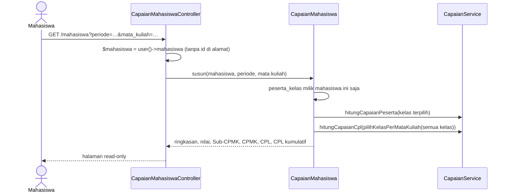

# 09 · Capaian Pembelajaran Mahasiswa

Catatan iterasi 9 (bagian 11 spesifikasi). Dibaca setelah [08-dashboard-laporan.md](08-dashboard-laporan.md).

## 1. Tujuan dan kebutuhan yang dipenuhi

Mahasiswa melihat nilai asesmen dan capaian Sub-CPMK, CPMK, serta CPL miliknya sendiri, tanpa aksi
ubah.

Kebutuhan yang dipenuhi:

- **KF-15:** mahasiswa melihat nilai dan capaiannya.
- **Bagian 6:** mahasiswa hanya bisa melihat datanya sendiri.
- **Skenario uji bagian 12:** nomor 15 (hanya nilai dan capaian mahasiswa itu yang tampil).

## 2. File yang dibuat atau diubah

| File | Peran |
|---|---|
| `app/Services/CapaianMahasiswa.php` | Menyusun pilihan periode/MK, rincian satu MK, dan CPL kumulatif per kurikulum |
| `app/Http/Controllers/Mahasiswa/CapaianMahasiswaController.php` | Halaman `/mahasiswa` |
| `resources/views/mahasiswa/capaian.blade.php`, `_tabel-capaian.blade.php` | Tampilan halaman |
| `resources/views/components/status-lulus.blade.php` | Badge Lulus / Belum Lulus / Belum ada nilai / Ambang belum ditetapkan |
| `routes/web.php` | Grup route Mahasiswa; halaman sambutan sementara dihapus |
| `tests/Feature/Mahasiswa/CapaianMahasiswaTest.php` | Test iterasi ini |

## 3. Alur kerja



## 4. Penjelasan potongan kode penting

### a. Hanya data milik sendiri

```php
$mahasiswa = $request->user()->mahasiswa;
abort_if($mahasiswa === null, 403);
...
PesertaKelas::with(...)->where('mahasiswa_id', $mahasiswa->mahasiswa_id)->get();
```

- **Tanpa id di alamat.** Alamat halaman tidak memuat id mahasiswa. Data selalu diambil dari akun yang
  sedang login.
- **Pilihan yang ketat.** Pilihan periode dan MK juga hanya dari kelas yang ia ikuti. Id MK lain yang
  diketik di alamat diabaikan.

### b. CPL kumulatif dipisah per kurikulum

```php
$cplKumulatif = $this->capaian->hitungCapaianCpl($this->capaian->pilihKelasPerMataKuliah($daftarPeserta));
...
Cpl::with('kurikulum')->whereIn('kurikulum_id', $idKurikulum)->get()->groupBy('kurikulum_id')
```

- **Satu mahasiswa, beberapa MK.** `CapaianService` menghitung CPL dari semua MK yang diikuti. Untuk
  MK yang diulang, dipakai kelas terbaru yang sudah bernilai (bagian 5.4).
- **Satu kartu per kurikulum.** Hasilnya dikelompokkan per kurikulum, jadi mahasiswa masa transisi
  melihat CPL kurikulum 2021 dan 2026 di kartu terpisah.

### c. Kontribusi satu MK ke CPL

```php
$cplMataKuliah = $this->capaian->hitungCapaianCpl([$peserta]);
```

Rincian CPL di bagian MK terpilih dihitung dari kelas itu saja, sedangkan CPL kumulatif dari semua
kelas. Keduanya memakai rumus 4 yang sama.

## 5. Hubungan dengan proposal dan spesifikasi

- **Bagian 7.6.10 (Gambar 3.15):**
  - kartu identitas serta dropdown Periode dan Mata Kuliah;
  - Ringkasan berupa 3 kartu angka besar;
  - tabel Detail Nilai Asesmen;
  - rincian per Sub-CPMK, CPMK, dan CPL dengan badge Lulus/Belum Lulus (≥ AM);
  - ringkasan CPL kumulatif yang dipisah per kurikulum;
  - tidak ada aksi ubah.
- **Bagian 5.3:** status Lulus memakai AM dari `.env`. Jika AM belum ditetapkan, tampil "Ambang belum
  ditetapkan".
- **Bagian 5.4:** nilai yang belum diinput tampil "Belum ada nilai", bukan 0.

## 6. Konsep Laravel yang muncul

- **Relasi `hasOne` lewat akun yang login:** `$request->user()->mahasiswa`.
- **`abort_if`:** menghentikan request dengan kode 403 jika syaratnya terpenuhi.
- **`@include` dengan data:** `@include('mahasiswa._tabel-capaian', ['baris' => ...])`. Satu tabel
  dipakai untuk Sub-CPMK, CPMK, dan CPL.
- **Spread array di `view()`:** `...$capaianMahasiswa->susun(...)` menggabungkan hasil service ke data
  view.

## 7. Cara mencoba dan menjalankan test

Setelah `php artisan migrate:fresh --seed`, login sebagai `mahasiswa@simonev.test` / `mahasiswa123`
atau dengan NPM `9992300001`:

1. **Periode berjalan.** Pilih periode 2026/2027 Ganjil dan MK INF101 atau INF301.
2. **Dua kurikulum.** Di bagian bawah tampil CPL Kumulatif Kurikulum OBE 2026 dan Kurikulum 2021,
   karena Mahasiswa Demo mengikuti MK dari kedua kurikulum.
3. **Data mahasiswa lain.** Login sebagai mahasiswa lain, mis. NPM `9992400001`. Data Mahasiswa Demo
   tidak terlihat.

```bash
php artisan test --filter=CapaianMahasiswaTest
```

## 8. Ringkasan iterasi

- **Tanggal:** 30 Oktober 2026.
- **Hasil test:** 273 test lulus (8 di antaranya baru), dan Pint bersih.
- **Tampilan:** halaman mahasiswa sudah dicek di 360, 768, dan 1280px tanpa geser horizontal.
- **Kendala dan perbaikannya:**
  - **Kartu mobile.** Sel tabel berisi dua bagian (nama asesmen dan metodenya) sempat terpisah ke
    kiri dan kanan. Isinya kini dibungkus satu elemen; perbaikan yang sama diterapkan di halaman
    Periode Akademik.
  - **Urutan asesmen di test.** Urutannya acak karena tanggal asesmen dari factory acak. Pembantu test
    kini memberi tanggal berurutan.
  - **Test lama PeranAktifTest.** Test itu membuat akun berperan Mahasiswa tanpa data mahasiswa,
    keadaan yang tidak mungkin terjadi (KD-36). Test-nya kini membuat data dosen/mahasiswa.
- **Perlu diputuskan:** tidak ada keputusan baru dari user. KD-71 adalah keputusan teknis.

## 9. Pertanyaan yang mungkin diajukan penguji

1. **Bagaimana sistem menjamin mahasiswa hanya melihat datanya sendiri?**
   Alamat halaman tidak memuat id mahasiswa. Semua data diambil dari akun yang sedang login, dan
   pilihan periode/MK hanya dari kelas yang ia ikuti (skenario uji 15).
2. **Apa beda "Kontribusi Mata Kuliah ke CPL" dan "CPL Kumulatif"?**
   Yang pertama dihitung dari MK terpilih saja. Yang kedua dari semua MK yang sudah diikuti, dan
   inilah capaian CPL mahasiswa sampai saat ini.
3. **Mengapa ada dua kartu CPL Kumulatif?**
   Mahasiswa itu mengikuti MK dari dua kurikulum. CPL dari kurikulum berbeda tidak pernah digabung
   walaupun kodenya sama (bagian 5.4).
4. **Apa arti status Lulus?**
   Capaian mahasiswa pada item itu ≥ Ambang Batas Kelulusan Mahasiswa (AM) dari `.env`, dibandingkan
   pada angka dua desimal (KD-39).
