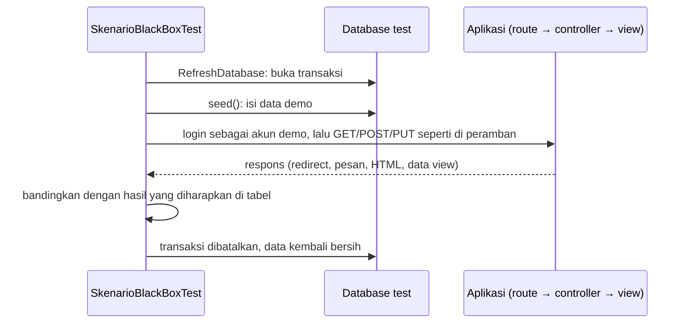
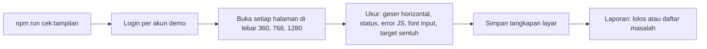

# 10 · Pengujian Black Box dan Tampilan Mobile

Catatan iterasi 10 (bagian 11 spesifikasi). Dibaca setelah [09-capaian-mahasiswa.md](09-capaian-mahasiswa.md).
Hasil pengujiannya ada di [docs/pengujian/black-box.md](../pengujian/black-box.md).

## 1. Tujuan dan kebutuhan yang dipenuhi

Iterasi ini membuktikan bahwa sistem memenuhi kriteria penerimaan:

- **Bagian 12:** 16 skenario uji black box, masing-masing punya feature test dan baris di dokumen
  hasil pengujian untuk Bab 4.
- **Bagian 7.4 dan KNF-04:** semua halaman nyaman dipakai di lebar 360 px tanpa geser horizontal.
  Font input di mobile minimal 16px dan target sentuh minimal 44×44 px.
- **Perbaikan:** temuan dari pengecekan langsung diperbaiki. Iterasi ini menemukan tombol Keluar di
  Pilih Peran yang terlalu kecil untuk disentuh.

## 2. File yang dibuat atau diubah

| File | Peran |
|---|---|
| `tests/Feature/SkenarioBlackBoxTest.php` | 16 test, satu per skenario, dengan data demo dari seeder |
| `scripts/cek-tampilan.mjs` | Membuka 51 halaman di Chrome pada 3 lebar layar, memeriksa tampilan, dan menyimpan tangkapan layar |
| `package.json`, `package-lock.json` | Perintah `npm run cek:tampilan` dan paket pengembangan `puppeteer-core` |
| `docs/pengujian/black-box.md` | Tabel hasil pengujian 16 skenario, uji mutasi, dan daftar tangkapan layar |
| `resources/views/peran-aktif/create.blade.php` | Tautan Batal dan tombol Keluar diperbesar menjadi minimal 44×44 px |
| `README.md`, `docs/catatan-kode/00-gambaran-umum.md` | Cara menjalankan skenario uji dan pengecekan tampilan |

## 3. Alur kerja

Feature test satu skenario:



Pengecekan tampilan:



## 4. Penjelasan potongan kode penting

### a. Setiap test memakai data demo

```php
protected function setUp(): void
{
    parent::setUp();

    $this->seed();
    config(['capaian.ambang_kelulusan_mahasiswa' => 50.01, 'capaian.ambang_ketercapaian' => 85]);
}
```

- **Data demo.** `$this->seed()` menjalankan `DatabaseSeeder`, jadi setiap test berangkat dari data
  yang sama dengan yang Anda lihat setelah `php artisan migrate:fresh --seed`. Karena itu, langkah di
  tabel pengujian bisa diulang secara manual dengan hasil yang sama.
- **Selalu bersih.** `RefreshDatabase` membungkus test dalam transaksi yang dibatalkan di akhir, jadi
  perubahan satu skenario tidak terbawa ke skenario lain.
- **Ambang.** Nilai ambang ditulis langsung, sama dengan `.env.example`, supaya hasil tidak bergantung
  pada isi `.env` di laptop.

### b. Prasyarat skenario dibuat langsung lewat model

```php
private function kelasHasilSkenario6(): KelasKuliah
{
    $kelas = KelasKuliah::factory()->create([... 'nama_kelas' => 'B']);
    $kelas->dosen()->attach(Dosen::where('nidn', '9990000001')->firstOrFail());

    return $kelas;
}
```

Skenario 7 dan 8 membutuhkan kelas INF102 B dari skenario 6. Test tidak boleh saling bergantung,
jadi keadaan "setelah skenario 6" dibuat ulang di awal test itu.

### c. Membaca isi tabel laporan

```php
return collect($response->assertOk()->viewData('hasil')['baris'])
    ->mapWithKeys(fn (array $baris) => [
        $baris['kode'] => $baris['rekap']['rata_rata'] === null ? 'Belum ada nilai' : Angka::format($baris['rekap']['rata_rata']),
    ])
    ->all();
```

- **Data view, bukan HTML.** `viewData('hasil')` mengambil data yang dikirim controller ke tabel
  Laporan Capaian. Hasilnya, mis. `['CPMK021' => '69,97', ...]`, dibandingkan utuh dengan
  `assertSame`.
- **Mengapa lebih ketat.** Cara ini lebih ketat daripada mencari teks di HTML, karena baris yang
  berlebih (mis. CPMK dari mata kuliah lain) langsung membuat test gagal.

### d. Pesan validasi diperiksa seperti di peramban

```php
$this->followingRedirects()
    ->from($halamanInput)
    ->put(route('dosen.nilai.update', $kuis), ['nilai' => [$peserta->peserta_kelas_id => '25']])
    ->assertOk()
    ->assertSee('Nilai tidak boleh lebih dari nilai maksimum (20).');
```

- **Alur di peramban.** Jika validasi gagal, Laravel mengalihkan kembali ke halaman form dan
  menyimpan pesan error di session untuk satu request berikutnya.
- **Di test.** `followingRedirects()` membuat test mengikuti pengalihan itu secara otomatis seperti
  peramban, sehingga yang diperiksa adalah pesan yang benar-benar tampil di halaman.

### e. Pemeriksaan tampilan di Chrome

```js
const ukuran = await page.evaluate(() => ({ lebarIsi: document.documentElement.scrollWidth, lebarLayar: window.innerWidth }));
...
if (ukuran.lebarIsi > ukuran.lebarLayar) {
    catat(lebar, halaman.nama, `halaman bergeser horizontal (...)`);
}
```

- **Geser horizontal.** Halaman bisa digeser jika lebar isinya (`scrollWidth`) lebih besar dari lebar
  layar. Matriks tidak ikut terhitung karena yang digeser wadahnya sendiri (`overflow-auto`), bukan
  halamannya.
- **Pemeriksaan mobile.** Fungsi `periksaMobile()` mengukur font setiap input dengan
  `getComputedStyle` dan ukuran setiap tombol, tautan ikon, dan lingkaran matriks dengan
  `getBoundingClientRect`.
- **Laporan.** Masalah yang sama di banyak halaman dikelompokkan jadi satu baris laporan.

## 5. Hubungan dengan proposal dan spesifikasi

- **Bagian 12:** tabel No, Fitur, Skenario, Langkah, Data uji, Hasil yang diharapkan, Hasil
  pengujian, dan Status diisi dari hasil `SkenarioBlackBoxTest`. Daftar tangkapan layar desktop dan
  mobile ada di bagian 5 dokumen hasil pengujian.
- **Bagian 7.4:** lebar 360/768/1280 px, tanpa geser horizontal kecuali isi matriks, font input
  ≥ 16px, dan target sentuh ≥ 44×44 px.
- **Bagian 5.5:** kebenaran rumus tetap dibuktikan unit test Uji 1–6 (data APTIKOM). Skenario 11
  memastikan hasilnya tampil di aplikasi.

## 6. Konsep yang muncul

- **Pengujian black box.** Sistem diuji dari luar: masukan yang diberikan dan keluaran yang tampil,
  tanpa melihat isi kode. Pengujian white box (unit test rumus) melengkapinya dari dalam.
- **`RefreshDatabase` + `seed()`.** Database test dikosongkan sekali, lalu setiap test berjalan di
  dalam transaksi yang dibatalkan setelah selesai.
- **`viewData()`** mengambil data yang dikirim controller ke view.
- **`followingRedirects()`** mengikuti redirect seperti peramban.
- **Puppeteer.** Pustaka JavaScript untuk mengendalikan Chrome lewat kode: membuka halaman, mengisi
  form login, mengukur elemen, dan menyimpan tangkapan layar. `puppeteer-core` adalah versi yang
  memakai Chrome yang sudah terpasang.
- **Uji mutasi.** Kode sengaja dirusak sedikit untuk membuktikan test bisa mendeteksinya. Test yang
  tetap lulus walau kodenya rusak berarti belum cukup ketat.

## 7. Cara mencoba dan menjalankan test

```bash
php artisan test --filter=SkenarioBlackBoxTest                     # 16 skenario
vendor/bin/phpunit --filter SkenarioBlackBoxTest --testdox         # daftar skenario yang mudah dibaca

php artisan migrate:fresh --seed && npm run build
php artisan serve                                                  # terminal 1
npm run cek:tampilan                                               # terminal 2
```

Tangkapan layar tersimpan di `storage/app/tangkapan-layar/360/`, `768/`, dan `1280/`. Untuk
pengujian manual, ikuti langkah di [black-box.md](../pengujian/black-box.md) bagian 3. Isi ulang data
demo sebelum skenario 11, karena skenario 4–9 mengubah data.

## 8. Ringkasan iterasi

- **Tanggal:** 30 Oktober 2026.
- **Hasil test:**
  - 289 test lulus (16 di antaranya baru: skenario 1–16), dan Pint bersih;
  - `SkenarioBlackBoxTest` lulus dengan 216 assertion;
  - `npm run cek:tampilan` lolos untuk 153 tangkapan layar;
  - uji mutasi: kelima aturan yang dirusak terdeteksi.
- **Kendala dan perbaikannya:**
  - **Target sentuh.** Pemeriksaan otomatis menemukan tombol Keluar di Pilih Peran berukuran
    42×20 px; kini minimal 44×44 px.
  - **Pesan validasi di test.** Pada percobaan pertama, pesan error tidak terlihat saat halaman
    dibuka ulang dengan `get()` terpisah setelah `assertSessionHasErrors()`. Pemeriksaannya diganti
    dengan `followingRedirects()`, yang mengikuti alur peramban.
  - **Selector skrip.** Tautan kelas di halaman Rencana Asesmen dicari lewat alamat `/dosen/kelas/`,
    karena alamat `/rencana-asesmen` juga cocok dengan tautan menu.
- **Perlu diputuskan:**
  - **Tangkapan layar.** Periksa daftar di black-box.md bagian 5, lalu ambil yang perlu dipotret
    manual (keadaan setelah aksi, mis. pesan sukses dan pesan validasi).
  - **Keputusan.** KD-72 dan KD-73 adalah keputusan teknis.

## 9. Pertanyaan yang mungkin diajukan penguji

1. **Bagaimana Anda tahu hasil di tabel pengujian benar?**
   Setiap baris diperiksa oleh feature test dengan data dan langkah yang sama, termasuk angka
   capaiannya. Jika aplikasi berubah dan hasilnya berbeda, test akan gagal.
2. **Bagaimana memastikan test-nya tidak selalu lulus?**
   Dengan uji mutasi. Lima aturan penting sengaja dirusak, misalnya batas nilai maksimum dan
   pembatasan laporan dosen, dan setiap kerusakan membuat skenario yang terkait gagal.
3. **Bagaimana tampilan mobile diuji?**
   Skrip membuka semua halaman di Chrome pada lebar 360, 768, dan 1280 px. Skrip mengukur apakah
   halaman bisa digeser horizontal, ukuran font input, dan ukuran target sentuh, lalu menyimpan
   tangkapan layarnya.
4. **Mengapa memakai data demo, bukan data asli?**
   Data asli mahasiswa tidak boleh dipakai atau di-commit. Data demo dirancang mencakup kasus penting:
   nilai yang belum diinput, mahasiswa di dua kurikulum, dan CPL yang belum diukur.
