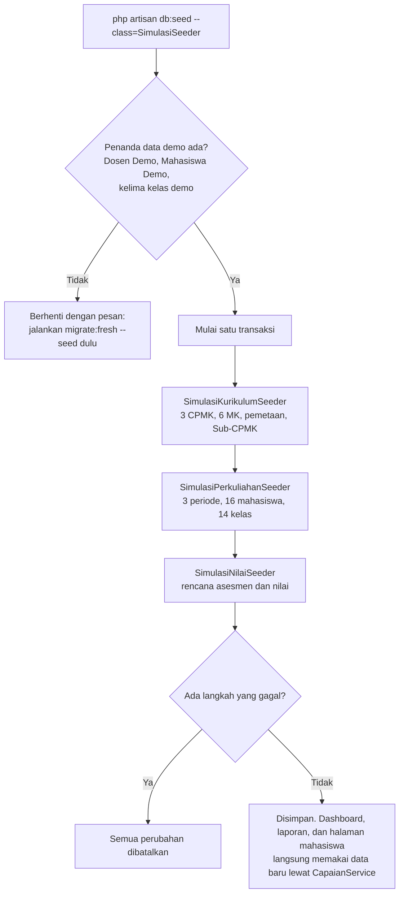

# 12 · Data Simulasi Dua Tahun

Catatan revisi setelah [11-dashboard-mahasiswa.md](11-dashboard-mahasiswa.md). Keputusannya dicatat
sebagai KD-77 sampai KD-80 di [keputusan-desain.md](../keputusan-desain.md).

## 1. Tujuan dan kebutuhan yang dipenuhi

Data demo (bagian 10 spesifikasi) hanya berisi dua periode, jadi grafik Perkembangan CPL per Periode
di Dashboard Mahasiswa hampir selalu kosong. Pemilik proyek meminta simulasi supaya proses capaian
pembelajaran terlihat sudah berjalan beberapa semester, sampai dua tahun, dan grafiknya bisa dilihat.

Revisi ini menambah **data simulasi** untuk tahun akademik 2024/2025 dan 2025/2026. Datanya dimasukkan
lewat seeder terpisah yang opsional, jadi data demo dan test lama tidak berubah. Bagian yang terbantu:

- **KF-12 dan KF-13 (Koprodi):** Dashboard Monitoring dan Laporan Capaian kini punya data dari lima
  periode, empat angkatan, dan sembilan MK Kurikulum 2021, sehingga filter periode dan angkatan
  menunjukkan perbedaan nyata.
- **KF-14 (Dosen):** Dosen Demo mengampu kelas simulasi di setiap periode, jadi laporannya juga bisa
  disaring per periode.
- **KF-15 dan bagian 5.3 (Mahasiswa):** grafik perkembangan mahasiswa angkatan 2023 dan 2024 punya
  lima titik, dari 2024/2025 Ganjil sampai 2026/2027 Ganjil.
- **Bagian 5.4:** ada contoh mahasiswa yang mengulang MK dan nilai yang kosong karena mahasiswanya
  tidak ikut asesmen.

Tidak ada tabel, kolom, atau rumus capaian yang berubah. Simulasi hanya mengisi tabel yang sudah ada.

## 2. File yang dibuat atau diubah

| File | Peran |
|---|---|
| `database/seeders/SimulasiSeeder.php` | Pintu masuk simulasi: memeriksa penanda data demo, lalu menjalankan tiga seeder di bawah dalam satu transaksi |
| `database/seeders/SimulasiKurikulumSeeder.php` | Menambah 3 CPMK dan 6 MK Kurikulum 2021 beserta pemetaan dan Sub-CPMK-nya |
| `database/seeders/SimulasiPerkuliahanSeeder.php` | Menambah 3 periode, 16 mahasiswa (angkatan 2022 dan 2025), dan 14 kelas |
| `database/seeders/SimulasiNilaiSeeder.php` | Mengisi rencana asesmen kelas simulasi dan nilai pesertanya |
| `database/seeders/PerkuliahanDemoSeeder.php` | Daftar kelas demo dipindah ke konstanta `DAFTAR_KELAS`; method baru `idKelasDemo()` |
| `database/seeders/AsesmenDemoSeeder.php`, `NilaiDemoSeeder.php` | Hanya mengisi kelas demo (KD-80); `KEMAMPUAN` jadi `public` supaya dipakai ulang |
| `database/seeders/PemetaanDemoSeeder.php` | Method pemetaan jadi `protected` supaya dipakai ulang oleh `SimulasiKurikulumSeeder` |
| `resources/views/mahasiswa/dashboard.blade.php` | Keterangan grafik perkembangan yang kosong kini menyebut kurikulum terpilih dan pilihan kurikulum lain |
| `tests/Feature/Database/SimulasiSeederTest.php` | 11 test data simulasi |
| `tests/Feature/Mahasiswa/DashboardMahasiswaTest.php` | Menyesuaikan teks keterangan grafik perkembangan |

## 3. Alur kerja



Jadwal kelas per angkatan (tanda * menandai kelas demo yang sudah ada sebelumnya):

| Periode | Angkatan 2022 | Angkatan 2023 | Angkatan 2024 | Angkatan 2025 | Angkatan 2026 |
|---|---|---|---|---|---|
| 2024/2025 Ganjil | INF301, INF302 | INF201, INF202 | INF103 | – | – |
| 2024/2025 Genap | INF303 | INF204 | INF105 | – | – |
| 2025/2026 Ganjil | Fitri mengulang INF302 | INF302 | INF203; Nanda dan Oktavia mengulang INF103 | INF103 | – |
| 2025/2026 Genap | – | INF303 | INF204, INF201* | INF105 | – |
| 2026/2027 Ganjil | – | INF301* | INF202* | – (simulasi tidak menambah kelas di periode aktif) | INF101*, INF102* |

Mahasiswa Demo (angkatan 2023) mengikuti semua kelas angkatan 2023, ditambah INF101* Kurikulum 2026.
INF201, INF202, dan INF301 diambil pada semester yang berbeda dari kolom semester MK-nya karena
periode kelas demo sudah ditetapkan sejak awal (KD-78).

MK dan CPMK tambahan untuk Kurikulum 2021:

| MK | Nama | Semester | CPMK (bobot) |
|---|---|---|---|
| INF103 | Algoritma dan Pemrograman | 1 | CPMK023 (60), CPMK012 (40) |
| INF105 | Pemrograman Berorientasi Objek | 2 | CPMK034 (50), CPMK023 (20), CPMK042 (30) |
| INF203 | Interaksi Manusia dan Komputer | 3 | CPMK031 (50), CPMK041 (30), CPMK011 (20) |
| INF204 | Rekayasa Perangkat Lunak | 4 | CPMK042 (40), CPMK032 (40), CPMK011 (20) |
| INF302 | Keamanan Aplikasi Web | 5 | CPMK033 (70), CPMK011 (30) |
| INF303 | Proyek Perangkat Lunak | 6 | CPMK032 (40), CPMK042 (30), CPMK041 (30) |

CPMK baru: CPMK023 (CPL02, algoritma dan struktur kontrol), CPMK033 (CPL03, keamanan aplikasi web),
dan CPMK034 (CPL03, pemrograman berorientasi objek).

## 4. Penjelasan potongan kode penting

### a. Seeder opsional dengan pengaman dan transaksi

```php
public function run(): void
{
    if (! $this->dataDemoLengkap()) {
        throw new RuntimeException('Data demo belum ada atau tidak lengkap. Jalankan "php artisan migrate:fresh --seed" terlebih dahulu.');
    }

    DB::transaction(fn () => $this->call([
        SimulasiKurikulumSeeder::class,
        SimulasiPerkuliahanSeeder::class,
        SimulasiNilaiSeeder::class,
    ]));
}

private function dataDemoLengkap(): bool
{
    return Dosen::where('nidn', '9990000001')->exists()
        && Mahasiswa::where('nim', '9992300001')->exists()
        && count(PerkuliahanDemoSeeder::idKelasDemo()) === count(PerkuliahanDemoSeeder::DAFTAR_KELAS);
}
```

- Simulasi dibangun di atas data demo: memakai CPL, dosen, mahasiswa 2023 dan 2024, serta kelas demo.
  Karena itu seeder memeriksa penanda yang hanya ada di data demo. Database yang berisi data lain
  tanpa data demo ditolak, jadi data karangan tidak tercampur dengan data asli prodi.
- `DB::transaction()` menjalankan ketiga seeder sebagai satu kesatuan. Jika satu langkah gagal,
  misalnya karena bahan kajian demo sudah dihapus lewat aplikasi, semua perubahan dibatalkan dan
  tidak ada data setengah jadi.
- `SimulasiSeeder` tidak ada di `DatabaseSeeder`, jadi `php artisan migrate:fresh --seed` dan semua
  test tetap memakai data demo saja (KD-77).

### b. Memakai ulang cara memetakan dari seeder demo

```php
class SimulasiKurikulumSeeder extends PemetaanDemoSeeder
{
    // ...
    $this->petakanBahanKajian($kurikulum, self::BAHAN_KAJIAN);
    $this->petakanCpmkDanSubCpmk($kurikulum, self::CPMK_DAN_SUB_CPMK);
}
```

`SimulasiKurikulumSeeder` adalah turunan `PemetaanDemoSeeder`. Method pemetaan di class induk diubah
dari `private` menjadi `protected`, jadi class turunan bisa memanggilnya. Datanya cukup ditulis dalam
array dengan format yang sama seperti data demo: MK → CPMK → [bobot, Sub-CPMK → [bobot, deskripsi,
metode]]. `run()` milik class turunan menggantikan `run()` milik induk, sehingga pemetaan demo tidak
diulang.

Beberapa helper kecil, misalnya membuat akun mahasiswa tanpa email, sengaja disalin ke seeder
simulasi. Dengan begitu seeder demo tidak perlu diubah hanya untuk dipakai bersama.

### c. Daftar kelas simulasi

```php
public const DAFTAR_KELAS = [
    ['INF103', '2024/2025', PeriodeAkademik::GANJIL, ['9990000005'], 2024, []],
    // ...
    ['INF103', '2025/2026', PeriodeAkademik::GANJIL, ['9990000005', '9990000001'], 2025, ['9992400007', '9992400008']],
];
```

Setiap baris berarti satu kelas A: kode MK, tahun akademik, semester, NIDN dosen, angkatan peserta, dan
NPM mahasiswa angkatan lain yang mengulang. Untuk setiap baris, seeder:

1. membuat periodenya jika belum ada (`firstOrCreate`);
2. membuat kelasnya;
3. mengatur dosen (`sync`);
4. menambah peserta (`syncWithoutDetaching`, peserta lama tidak dihapus).

Peserta hanya diambil dari mahasiswa contoh, yaitu yang NPM-nya diawali `999`:

```php
Mahasiswa::where('nim', 'like', '999%')
    ->where(fn ($query) => $query->where('angkatan', $angkatan)->orWhereIn('nim', $nimMengulang))
```

Konstanta `DAFTAR_KELAS` dibuat `public` karena `SimulasiNilaiSeeder` membaca daftar yang sama untuk
mengisi nilai.

### d. Rumus nilai simulasi

```php
$persen = NilaiDemoSeeder::KEMAMPUAN[$urutan % count(NilaiDemoSeeder::KEMAMPUAN)]
    - self::PERUBAHAN_PER_SEMESTER[$urutan % count(self::PERUBAHAN_PER_SEMESTER)] * $jarakKeSemesterTerakhir
    + self::PENYESUAIAN_MATA_KULIAH[$kodeMataKuliah]
    + self::PENYESUAIAN_METODE[$asesmen->metodePenilaian->kode_metode]
    + (in_array($nim, $nimMengulang, true) ? self::TAMBAHAN_MENGULANG : 0)
    + $this->variasi($nim, $kodeMataKuliah, $periode->nama(), $asesmen->nama_asesmen);
```

Baca dari atas ke bawah:

1. **Kemampuan dasar.** Diambil dari daftar yang sama dengan `NilaiDemoSeeder`, sesuai urutan NPM
   mahasiswa contoh di angkatannya. Hendra (urutan pertama angkatan 2024) mendapat 88, sama seperti
   di kelas demo.
2. **Perubahan per semester.** `$jarakKeSemesterTerakhir` bernilai 3 di 2024/2025 Ganjil dan 0 di
   2025/2026 Genap. Mahasiswa dengan perubahan +4 (Hendra) mulai dari 88 − 12 = 76, lalu naik 4 poin
   setiap semester sampai 88 di 2025/2026 Genap. Kemampuan Kartika turun 2 poin per semester. Karena
   MK awal lebih sulit, nilainya tampak datar, tetapi ia makin tertinggal dari Hendra.
3. **Penyesuaian MK dan metode.** MK yang sulit, mis. INF103 (−6), dan ujian (UAS −5) cenderung lebih
   rendah; tugas (+5) dan proyek (+4) lebih tinggi.
4. **Tambahan mengulang.** Mahasiswa yang mengulang mendapat +12 karena sudah pernah mempelajari
   materinya.
5. **Variasi.** Angka −6 sampai +6 supaya nilai tidak terlalu seragam.

Hasilnya dibatasi 0–100, lalu diubah ke skala nilai maksimum asesmen dan dibulatkan satu desimal,
sama seperti `NilaiDemoSeeder`. Nilai hanya diisi untuk asesmen dari rencana simulasi dan untuk
mahasiswa contoh. Asesmen yang ditambahkan dosen, dan mahasiswa lain yang dimasukkan Admin ke kelas
simulasi, tidak disentuh, sehingga nilainya tidak tertimpa saat seeder dijalankan ulang.

### e. Variasi yang tampak acak tetapi tetap

```php
private function variasi(string ...$bagian): int
{
    return crc32(implode('|', $bagian)) % 13 - 6;
}
```

`crc32()` mengubah teks menjadi bilangan bulat. Teks yang sama selalu menghasilkan bilangan yang sama,
jadi `"9992400001|INF103|2024/2025 Ganjil|UTS"` selalu memberi variasi yang sama. Sisa bagi 13
menghasilkan 0–12, lalu dikurangi 6 menjadi −6 sampai +6. Dengan cara ini seeder tidak memakai fungsi
acak, sehingga hasilnya selalu sama setiap dijalankan (KD-79).

### f. Seeder demo hanya mengisi kelas demo

```php
$daftarKelas = KelasKuliah::with([...])
    ->whereIn('kelas_kuliah_id', PerkuliahanDemoSeeder::idKelasDemo())
    ->get();
```

Sebelumnya `AsesmenDemoSeeder` dan `NilaiDemoSeeder` mengisi **semua** kelas. Jika `php artisan
db:seed` dijalankan lagi setelah simulasi, kelas simulasi ikut tertimpa. Kini keduanya hanya mengisi
kelas yang tercantum di `PerkuliahanDemoSeeder::DAFTAR_KELAS`. `idKelasDemo()` mencari id setiap kelas
itu berdasarkan kode MK, tahun kurikulum, periode, dan nama kelas (KD-80).

### g. Tanggal asesmen hari Senin

```php
$awal = $periode->semester_periode === PeriodeAkademik::GANJIL
    ? Carbon::create($tahunAwal, 9, 1)
    : Carbon::create($tahunAwal + 1, 2, 16);

return $awal->isMonday() ? $awal : $awal->next(Carbon::MONDAY);
```

Tanggal asesmen = hari pertama kuliah + (minggu ke- − 1) × 7 hari. 1 September 2024 dan 16 Februari
2025 jatuh pada hari Minggu, jadi hari pertama kuliah digeser ke Senin berikutnya. Dengan begitu semua
asesmen jatuh pada hari Senin, sama seperti kelas demo.

## 5. Hubungan dengan proposal dan spesifikasi

| Bagian | Penerapan |
|---|---|
| Bagian 4 (ERD) | Tidak ada tabel atau kolom baru. Simulasi mengisi `periode_akademik`, `mata_kuliah`, `cpmk`, `pemetaan_bk_mk`, `pemetaan_cpmk_mk`, `sub_cpmk`, `sub_cpmk_penilaian`, `users`, `user_roles`, `mahasiswa`, `kelas_kuliah`, `dosen_kelas`, `peserta_kelas`, `rencana_asesmen`, `rencana_asesmen_sub_cpmk`, dan `nilai_asesmen` |
| Bagian 5.1 | Semua bobot simulasi memenuhi aturannya; diperiksa `MatriksBobotKelas` di test |
| Bagian 5.3 | Grafik perkembangan dan laporan per periode memakai CPL kumulatif dan per periode yang sudah ada |
| Bagian 5.4 | Contoh mahasiswa mengulang (kelas terbaru yang sudah bernilai dipakai) dan nilai kosong (diabaikan) |
| Bagian 10 | Semua data karangan; mahasiswa contoh tanpa email, login dengan NPM dan `mahasiswa123` |
| Bagian 14 | Rumus capaian tetap hanya di `CapaianService`; rumus di `SimulasiNilaiSeeder` hanya membuat nilai contoh |

Hasil laporan Koprodi untuk Kurikulum 2021 setelah simulasi (tab CPL, persentase mahasiswa Lulus,
✓ = Tercapai jika ≥ 85%):

| Periode | CPL01 | CPL02 | CPL03 | CPL04 | CPL Tercapai |
|---|---|---|---|---|---|
| 2024/2025 Ganjil | 83,33 ✗ | 62,50 ✗ | 75,00 ✗ | 75,00 ✗ | 0 dari 4 |
| 2024/2025 Genap | 87,50 ✓ | 85,71 ✓ | 79,17 ✗ | 83,33 ✗ | 2 dari 4 |
| 2025/2026 Ganjil | 80,00 ✗ | 60,00 ✗ | 70,59 ✗ | 100,00 ✓ | 1 dari 4 |
| 2025/2026 Genap | 87,50 ✓ | 87,50 ✓ | 87,50 ✓ | 87,50 ✓ | 4 dari 4 |
| 2026/2027 Ganjil | – | 87,50 ✓ | 87,50 ✓ | 87,50 ✓ | 3 dari 3 |
| Kumulatif | 81,25 ✗ | 70,83 ✗ | 84,38 ✗ | 87,50 ✓ | 1 dari 4 |

Catatan tabel:

- Penurunan di 2025/2026 Ganjil berasal dari angkatan 2025 yang baru masuk dan dua mahasiswa yang
  mengulang INF103, MK tersulit di simulasi.
- CPL02 di 2024/2025 Genap dihitung dari 7 mahasiswa, karena satu mahasiswa tidak ikut satu-satunya
  asesmen CPL02 di periode itu.
- Banyak angka 87,50 karena setiap kelas berisi 8 mahasiswa dengan satu mahasiswa yang belum lulus.

## 6. Konsep yang muncul

- **Seeder dan `$this->call()`.** Seeder mengisi database lewat kode. `$this->call([...])` menjalankan
  beberapa seeder berurutan. Seeder tertentu dijalankan dengan `php artisan db:seed --class=NamaSeeder`.
- **Transaksi database (`DB::transaction`).** Sekumpulan perubahan disimpan bersama-sama, atau
  dibatalkan semuanya jika ada yang gagal.
- **`firstOrCreate`, `updateOrCreate`, `sync`, `syncWithoutDetaching`.** Mencari data dulu dan hanya
  membuat atau memperbarui jika perlu. Karena itu seeder aman dijalankan berulang tanpa data ganda.
- **Pewarisan (`extends`) dan `protected`.** Class turunan bisa memakai method `protected` milik class
  induknya, tetapi kode di luar kedua class itu tidak bisa.
- **Konstanta dan method `static`.** `DAFTAR_KELAS` dan `idKelasDemo()` milik class, bukan milik objek,
  jadi bisa dipanggil langsung, misalnya `PerkuliahanDemoSeeder::idKelasDemo()`.
- **Carbon.** `Carbon::create(2024, 9, 1)->next(Carbon::MONDAY)->addWeeks(7)` menghitung tanggal Senin
  di minggu ke-8 kuliah.
- **`RuntimeException`.** Menghentikan seeder dengan pesan kesalahan yang jelas.
- **`$this->seed(NamaSeeder::class)` di test.** Menjalankan seeder tertentu di database test.

## 7. Cara mencoba dan menjalankan test

Data simulasi ditambahkan di atas data demo:

```bash
php artisan migrate:fresh --seed              # jika database belum berisi data demo
php artisan db:seed --class=SimulasiSeeder    # menambah riwayat 2024/2025 dan 2025/2026
```

Akun untuk melihat hasilnya (password mahasiswa `mahasiswa123`):

| Akun | Halaman | Yang terlihat |
|---|---|---|
| Hendra Kurniawan (9992400001) | Dashboard | Semua CPL naik dari 2024/2025 Ganjil sampai 2026/2027 Ganjil |
| Nanda Firmansyah (9992400007) | Dashboard | Mengulang INF103 di 2025/2026 Ganjil; CPL02 naik dari 44,62 menjadi 51,75 (Lulus) |
| Oktavia Rahma (9992400008) | Dashboard | Ikut mengulang INF103; CPL-nya naik tetapi masih di bawah ambang |
| Mahasiswa Demo (`mahasiswa@simonev.test`) | Dashboard | Pilih **Kurikulum 2021** di bagian atas; bawaannya Kurikulum OBE 2026 |
| Koprodi (`koprodi@simonev.test`) | Dashboard, Laporan Capaian | Pilih **Kurikulum 2021**, lalu bandingkan periode 2024/2025 Ganjil dengan 2025/2026 Genap |
| Dosen Demo (`dosen@simonev.test`) | Laporan Capaian | Pilih Kurikulum 2021; kelasnya ada di setiap periode simulasi |

Data simulasi dihapus dengan `php artisan migrate:fresh --seed` (kembali ke data demo saja).

Menjalankan test:

```bash
php artisan test --filter=SimulasiSeederTest   # 11 test data simulasi
php artisan test                               # semua test
```

`SimulasiSeederTest` memeriksa:

- periode, jumlah kelas dan mahasiswa, periode aktif yang tetap 2026/2027 Ganjil, dan akun mahasiswa
  simulasi (tanpa email, password `mahasiswa123`, peran MAHASISWA);
- semua bobot kurikulum dan rencana asesmen memenuhi aturan 5.1, termasuk Σ kontribusi setiap asesmen;
- nilai di antara 0 dan nilai maksimum, serta tanggal asesmen di dalam semesternya dan bukan akhir
  pekan;
- semua CPL Hendra naik, dan jaraknya dengan Kartika melebar dari semester pertama ke semester
  keempat;
- semua mahasiswa angkatan 2022–2025 punya grafik perkembangan, dan angkatan 2023–2024 punya lima
  periode;
- Nanda yang mengulang memakai kelas terbaru, lalu CPL02-nya melewati ambang;
- data demo dan mahasiswa lain (NPM bukan 999…) tidak berubah oleh simulasi;
- seeder demo dan simulasi bisa dijalankan ulang tanpa data ganda, tanpa mengubah nilai, tanpa
  menimpa asesmen buatan dosen, dan tanpa memberi nilai kepada mahasiswa lain yang dimasukkan Admin;
- pengaman jika data demo tidak ada atau tidak lengkap, dan pembatalan semua perubahan jika simulasi
  gagal di tengah jalan;
- Dashboard Koprodi, Laporan Capaian, dan Dashboard Mahasiswa bisa dibuka dengan data simulasi.

## 8. Ringkasan revisi

- **Tanggal:** 5 November 2026.
- **Hasil:**
  - 316 test lulus (11 di antaranya baru, di `SimulasiSeederTest`), 5.064 assertion, dan Pint bersih.
  - `npm run cek:tampilan` dengan data simulasi di database pengembangan menghasilkan 159 tangkapan
    layar tanpa masalah.
  - Uji mutasi: 16 mutasi pada seeder simulasi dan seeder demo, semuanya tertangkap test. Contohnya
    menghapus batasan kelas demo, bobot UAS yang salah, tanpa tambahan mengulang, tanpa transaksi,
    tanpa batasan NPM 999, tanggal yang tidak digeser ke Senin, dan salah ketik jadwal kelas.
- **Kendala:**
  - Tangkapan layar satu halaman penuh (`fullPage`) dari puppeteer sempat menampilkan grafik kosong.
    Ini terjadi karena ukuran layar berubah saat pengambilan gambar, sehingga Chart.js menggambar ulang.
    Grafiknya sendiri normal; pemeriksaan visual memakai layar setinggi halaman.
  - Uji mutasi awal menunjukkan test "Hendra naik" tetap lulus walaupun perubahan per semester dihapus,
    karena tingkat kesulitan MK saja sudah membuat grafik naik. Test diperketat dengan membandingkan
    Hendra dan Kartika di semester pertama dan keempat.
  - Review independen menemukan pengaman yang terlalu longgar, tanggal asesmen 2024/2025 yang jatuh
    pada hari Minggu, dan nilai asesmen buatan dosen yang bisa tertimpa. Semuanya sudah diperbaiki dan
    diuji.
- **Perlu diputuskan:**
  - Grafik Laporan Capaian tab CPMK (23 item) dan Sub-CPMK (31 item) Kurikulum 2021 terlalu sesak di
    layar desktop. Usulnya: batang mendatar juga dipakai di desktop jika ruang per item sempit, seperti
    di mobile. Ini mengubah tampilan yang ditetapkan bagian 7.6.9, jadi perlu persetujuan.
  - Bawaan Dashboard Mahasiswa adalah kurikulum terbaru (KD-75), jadi Mahasiswa Demo perlu memilih
    Kurikulum 2021 untuk melihat riwayat dua tahun.
  - Apakah simulasi perlu menambah kelas di periode aktif (mis. angkatan 2025 semester 3), atau dijadikan
    data demo bawaan.

## 9. Pertanyaan yang mungkin diajukan penguji

1. **Apakah data simulasi ini data asli?** Bukan. Semua nama, NPM, MK tambahan, dan nilai adalah
   karangan untuk memperlihatkan cara kerja sistem setelah dipakai beberapa semester (bagian 10).
2. **Kenapa nilainya tidak diacak?** Supaya hasilnya selalu sama setiap seeder dijalankan. Dengan
   begitu grafik bisa dijelaskan, angka di catatan ini tetap benar, dan test bisa memeriksa ceritanya.
   Variasi dibuat dari `crc32`, yang selalu memberi angka yang sama untuk teks yang sama.
3. **Apakah rumus di `SimulasiNilaiSeeder` melanggar aturan "rumus hanya di CapaianService"?** Tidak.
   Rumus itu hanya membuat nilai asesmen contoh, seperti dosen yang mengisi nilai. Capaian Sub-CPMK,
   CPMK, dan CPL dari nilai itu tetap dihitung oleh `CapaianService`.
4. **Bagaimana jika seeder dijalankan dua kali?** Datanya tidak ganda, karena seeder memakai
   `firstOrCreate`, `updateOrCreate`, dan `syncWithoutDetaching`. Nilainya juga sama karena rumusnya
   tetap. Hal ini diperiksa test.
5. **Bagaimana jika seeder gagal di tengah jalan?** Ketiga seeder simulasi berjalan dalam satu
   transaksi, jadi semua perubahan dibatalkan dan database kembali seperti sebelum seeder dijalankan.
   Test menghapus satu bahan kajian demo untuk memaksa kegagalan, lalu memeriksa tidak ada data yang
   tersisa.
6. **Kenapa simulasi tidak dimasukkan ke data demo bawaan?** Test dan dokumen pengujian black box
   memakai angka dari data demo. Dengan seeder terpisah, data demo tetap sama dan simulasi bisa
   ditambahkan kapan saja dengan satu perintah.
7. **Kenapa angkatan 2024 mengambil Struktur Data (semester 3) di semester 4?** Kelas itu adalah kelas
   demo yang periodenya sudah ditetapkan sejak awal. Simulasi menyesuaikan jadwalnya supaya tidak
   mengubah data demo.
8. **Kenapa grafik Mahasiswa Demo bawaannya tidak menampilkan simulasi?** Dashboard memilih kurikulum
   terbaru yang diikuti (KD-75). Mahasiswa Demo juga mengikuti satu MK Kurikulum 2026, jadi
   riwayat dua tahunnya ada di pilihan Kurikulum 2021. Keterangan di kartu grafik menyebutkan hal ini.
